# How It Works — an illustrated guide

This is the walkthrough for the *LitRPG Storyboard Tracker* engine: what happens
between drawing a line on the canvas and finding a row in the database, which
module owns which part of that trip, and what four ordinary pieces of work look
like end to end.

It is written for whoever changes the app:

- **Developers** who have to change it — the domain boundaries, the command
  names, and where a new feature belongs.
- **Anyone** who wants to know why the app behaves as it does — why a skill rename
  reaches every sheet, why a connection is not "just a line".

**If you are here to use the app rather than to change it, read
[`STORYBOARDING.md`](STORYBOARDING.md) instead.** That is the author's guide: what
to click, in what order, to plot a story and keep its numbers straight, with the
same pictures. It is what the header's **Guide** button opens in the app, and this
document is what happens underneath it.

For the schema, the audit model and the data location,
[`README.md`](README.md) is the reference and is not repeated here.

The screenshots are of the real app, rendered against a sample story — see
[How the pictures were taken](#how-the-pictures-were-taken).

---

## Contents

1. [The mental model](#1-the-mental-model)
2. [One change, all the way down](#2-one-change-all-the-way-down)
3. [The domains and how they relate](#3-the-domains-and-how-they-relate)
4. [Workflow A — a cast member, a card, and their numbers](#4-workflow-a--a-cast-member-a-card-and-their-numbers)
5. [Workflow B — a skill card, its holders, ranks and chapters](#5-workflow-b--a-skill-card-its-holders-ranks-and-chapters)
6. [Workflow C — chapters on the sheet and on the board](#6-workflow-c--chapters-on-the-sheet-and-on-the-board)
7. [Workflow D — history, the audit log and the trash](#7-workflow-d--history-the-audit-log-and-the-trash)
8. [Where to change what](#8-where-to-change-what)
9. [Visual asset checklist](#9-visual-asset-checklist)

---

## 1. The mental model

Three rules explain almost every behaviour in the app. They are the same three the
first-run card lists in one line each, and the same three
[`STORYBOARDING.md`](STORYBOARDING.md) closes with. (That is the document the app's
**Guide** button opens — the author's guide. This one is for whoever is changing
the code, and it starts by explaining the same three rules from the inside.)

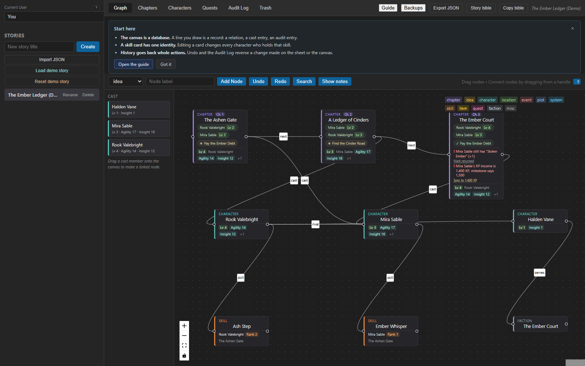

*The first-run card. **Open the guide** opens this file where it is read; the card
itself lists the three rules one line each and then gets out of the way.*

**1. The canvas is a database.** A card is a row; a connection is a row. Drawing a
line between two character cards does not decorate the board, it writes a
`character_relations` record and an audit entry. Connecting a character to a
chapter writes a `chapter_cast` row. Connecting a character to a skill card gives
that character the skill.

**2. A skill card has one identity.** A skill's name, rank and effect belong to
the skill, not to the card or to one holder. Editing a card's label or notes
rewrites every holder's row in the same transaction, which is why a correction
made in one place appears on every sheet that holds it — as one undo step.

**3. History goes back whole actions.** One save is one step, even when it touched
a card and a sheet together. Undo and Redo walk those steps; the Audit Log keeps
the longer record of who changed what, with a Revert on each field.

Underneath those three rules is one more idea that shapes the code: **the UI never
decides a domain fact.** Whether a bond is symmetric, whether two skills may
evolve into each other, whether a chapter's XP adds up, what a sheet held at
chapter 2 — the database answers, and the UI shows the answer.

---

## 2. One change, all the way down

Every write travels the same five stages, in this order.

```
   ┌─────────────────────────┐
   │ src/domains/canvas/     │   React Flow board, cards, cast rail,
   │   GraphTab.tsx          │   drawers, dialogs          ("the view")
   │   GraphNode.tsx         │
   └───────────┬─────────────┘
               │  a handler: drop, click, submit
   ┌───────────▼─────────────┐
   │ a domain hook           │   useCanvasDrafts · useCanvasInspector
   │ src/domains/<d>/*.ts    │   useSkillHolderForm · useChapterWorkspace
   │                         │   useHistory · useSheetStats …
   └───────────┬─────────────┘
               │  an intent, with the facts it needs
   ┌───────────▼─────────────┐
   │ src/domains/<d>/api.ts  │   the ONLY place a command name, its
   │                         │   arguments and its answer type exist
   └───────────┬─────────────┘
               │  invoke('set_node_character', { nodeId, characterId, user })
   ┌───────────▼─────────────┐
   │ src-tauri/src/lib.rs    │   106 #[tauri::command] wrappers:
   │                         │   camelCase in, snake_case through, String errors out
   └───────────┬─────────────┘
               │  a Db method call
   ┌───────────▼─────────────┐
   │ src-tauri/db/src/lib.rs │   one transaction: the row(s), a renumbering,
   │                         │   the cascade — and the audit entry beside them
   └───────────┬─────────────┘
               │  the row it wrote
   ┌───────────▼─────────────┐
   │ React state in App.tsx  │   and the tab panel that reads it re-renders
   └─────────────────────────┘
```

Three properties of that pipeline are worth stating plainly, because a lot of the
code is there to keep them true.

**The command layer is the only door.** `@tauri-apps/api/core`'s `invoke` is
called in exactly one kind of file — `src/domains/<domain>/api.ts`. There is no
`invoke` anywhere else in `src/` outside the tests. So the answer to "what does
this button write?" is always one function away, and the answer to "who calls this
command?" is a grep in one directory. The frontend names 98 distinct commands; the
desktop crate registers 106 handlers.

**The audit entry is written with the change, not after it.** If the entry cannot
be written the change is rolled back rather than committed unattributed. That is a
database-layer guarantee (`log_audit` inside the same transaction), so no UI path
can forget it.

**The app re-reads rather than guesses.** After an undo, a revert from the audit
log or a story switch, the board and the panels are read again from the database
instead of being patched in memory. `reloadStory` and `loadStory` in `App.tsx` are
the two places that do it, and they exist because a restored row brings its
connections with it — a fact no local patch can know.

### What a "step" is

Undo is a stack of steps, not a stack of rows. `src/domains/history/useHistory.ts`
holds the two stacks and each step is `{ label, undo, redo }` — a label for the
notice ("Add holder", "Relink 'The Ashen Gate'") and the two writes that walk it
back and forward. The rules that make it feel reliable:

- **A step is recorded only after the write succeeded.** A refused write leaves
  no step behind, so pressing Undo can never "undo" something that did not happen.
- **One gesture is one step** even when it wrote two rows: a relation and its
  connection, a cast member and its connection, a card and the row behind it.
- **A step that could not finish is put back whole.** The half that had already
  been written is deleted, and the attempt is written into the Audit Log as
  `step_rolled_back` rather than left to a fading notice.
- **A refusal is a fact about the story.** An Undo or Redo the database refuses is
  recorded as `undo_refused` / `redo_refused`, with the reason.
- **Undo is scoped to the open story.** Switching stories forgets the stacks,
  because an undo that reached across a story switch would be editing a board the
  author is no longer looking at.
- **Undo does not touch unsaved typing.** An open drawer follows the stored row
  unless it holds text the author has not saved (`useCanvasDrafts` keeps the dirty
  flags and the half-written text remembered per card).

---

## 3. The domains and how they relate

`src/App.tsx` is the orchestrator: it owns the open story, the loaded rows, the
handlers and the tab layout. Everything that does not need all of that lives in a
domain folder beside it.

```
src/
├── App.tsx                     the story, the rows, the handlers, the tab layout
├── components/                 shared widgets (HelpTip, SuggestionInput, view toggle)
├── lib/format.ts               small formatting helpers
└── domains/
    ├── shared/                 row types more than one domain reads
    ├── canvas/                 board, cards, cast rail, drafts, inspector, holder form
    ├── narrative/              chapters, their cast, their notes, the chapter logic
    ├── characters/             the sheet: stats, attributes, items, currency, bonds
    ├── skills/                 the skill section, the tree and its loop guard
    ├── quests/                 the ledger: quests, rewards, apply-to-ledger
    ├── progression/            XP, levels, milestones, the power curve
    ├── relations/              the cast map and the faction standings
    ├── inventory/              items and currency commands (the sheet draws them)
    ├── audit/                  the history tab, its filters and its rows
    ├── trash/                  the two deleted lists and the retention window
    ├── stories/                the shelf: rename, delete, import, export, backups
    ├── search/                 the Ctrl+F palette over the board and other stories
    └── history/                the undo and redo stacks
```

| Domain | Owns | Reads and writes through |
| --- | --- | --- |
| **canvas** | The board, the card, the cast rail, the connection editor, the inspector drawer, which card or line is open, the drafts typed into a drawer, and the skill card's holder form | `get_graph_nodes`, `get_graph_edges`, `create_graph_node`, `update_graph_node`, `set_node_character`, `create_graph_edge`, `update_graph_edge`, `delete_node`, `delete_edge`, `add_skill` (a holder) |
| **narrative** | Chapters: reading order, arcs, POV, day and time, word counts, the cast on a chapter, the notes under it, and the continuity advisories the chapter cards raise | `set_chapter_order`, `set_chapter_details`, `get_story_chapter_cast`, `get_story_chapter_cast_states`, `add_chapter_cast_member`, `add_chapter_note`, `update_chapter_note` |
| **characters** | The sheet's sections — attributes, stats, items, currency, bonds, faction standings, level rows and XP by chapter — each keeping its own open row and draft fields | `get_character_stats`, `set_character_stat`, `get_character_attributes`, `get_character_inventory`, `get_character_currency`, `get_character_state_at_chapter` |
| **skills** | The skill section on a sheet, what a level-up did to a skill (`used`, `upgraded`, `sacrificed`), and the evolution tree with its cycle guard | `add_skill`, `update_skill`, `delete_skill`, `add_skill_event`, `add_skill_evolution`, `get_story_skill_evolutions` |
| **quests** | The ledger: quest drafts, reward drafts, the status filter, the apply notices, and the continuity warnings a payout raises | `get_story_quests`, `add_quest`, `update_quest`, `add_quest_reward`, `mark_quest_rewards_applied` |
| **audit** | One page of history, the entity filter, the extendable window, and the revert notices | `get_audit_history`, `revert_change`, `record_history_event` |
| **trash** | Both deleted lists (the open story's, and the stories themselves), which row is waiting on a permanent-delete confirmation, and the retention window | `get_trash`, `get_trash_retention`, `set_trash_retention`, `restore_deleted`, `purge_deleted` |
| **progression** | The power curve: which metric, which cast members are shown, the chapter the sheet is read as of, the whole sheet — stats, skills and carried items — that chapter opens, what a level hands out, and the gains that skipped a level-up | `get_story_level_milestones`, `get_story_level_growth_rules`, `get_story_character_awards`, `get_story_character_progress`, `get_character_state_at_chapter` |

A level is the one number with a single owner: `characters.level` is a cache the
database rewrites from the last level-up recorded (`refresh_character_level`), so
the sheet, the cast rail and the cards cannot disagree with the milestones, and
`set_character_progress` deliberately has no level argument. Growth rules and
awards are the other half of the same idea: a rule is a promise the level-up form
reads, and an award applies its own amount when it is written so the record and the
sheet or chapter income never drift.

The arrows between domains all pass through `App.tsx`. A chapter card asking for a
cast member's level reads the rows `App.tsx` already loaded; the quest ledger
handing a payout to the sheet calls back into the app's setter. No domain imports
another domain's state, and `src/domains/<domain>/api.ts` is the only file that
knows a command name.

On the Rust side there are two crates, and the split is the reason the database
can be tested without a window:

- **`src-tauri/db`** — `Db`, the migrations, every query, the audit log and the
  launch snapshots. In-memory SQLite drives 184 tests.
- **`src-tauri/src`** — the Tauri commands: thin wrappers that map camelCase
  arguments to the snake_case parameters, turn errors into strings, and register
  the 106 handlers.

---

## 4. Workflow A — a cast member, a card, and their numbers

*Goal: get Mira onto the board as a card that is linked to her sheet, then read
her numbers without leaving the canvas.*

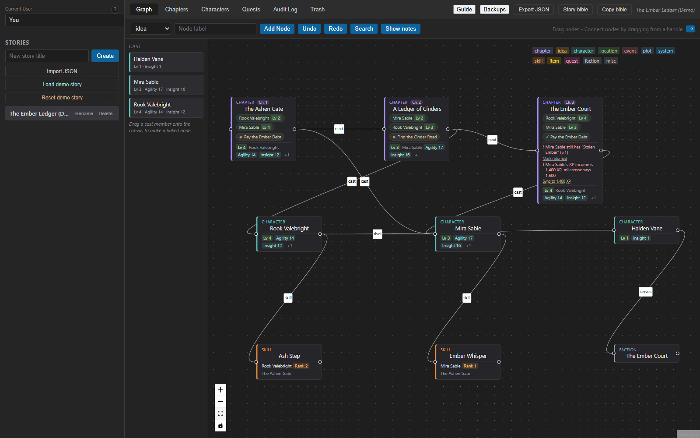

*The Graph tab. Three chapter cards along the top (each carrying its cast badges,
the quests that touch it and its own continuity warnings), the cast rail on the
left, character cards in the middle, skill cards and a faction card below. Every
line is labelled with what it means: `next` between chapters, `cast` from a chapter
to a cast member, `skill` from a character to a skill they hold, `rival` / `enemy`
between two characters.*

### The easy route: drop a cast member on the board

1. **Drag a name out of the cast rail.** `GraphTab` puts the character's id in the
   drag payload under `CAST_DRAG_TYPE`, so the drop knows whose drag it is before
   any state catches up.
2. **Drop it on empty canvas** → `dropCastMember` in `App.tsx` calls
   `createGraphNode(…, 'character', name, null, x, y, actor, characterId)`. One
   command creates the card *and* its link, so a refused link leaves nothing
   behind. The new card opens immediately, because the drop is not finished until
   the numbers are visible.
3. **Drop it on an existing card instead** → `set_node_character` points that card
   at the member. `App.tsx` records one step, `Relink "<card>"`, whose undo puts the
   previous link back and whose redo restores this one. If the card's label was the
   *old* member's name, the app offers the rename rather than taking it — the label
   is the author's.

### The same thing with a connection

Dragging from a card's handle to another card is the canvas gesture; what it does
depends on what the two ends are. Between two character cards it asks for the
relation first:

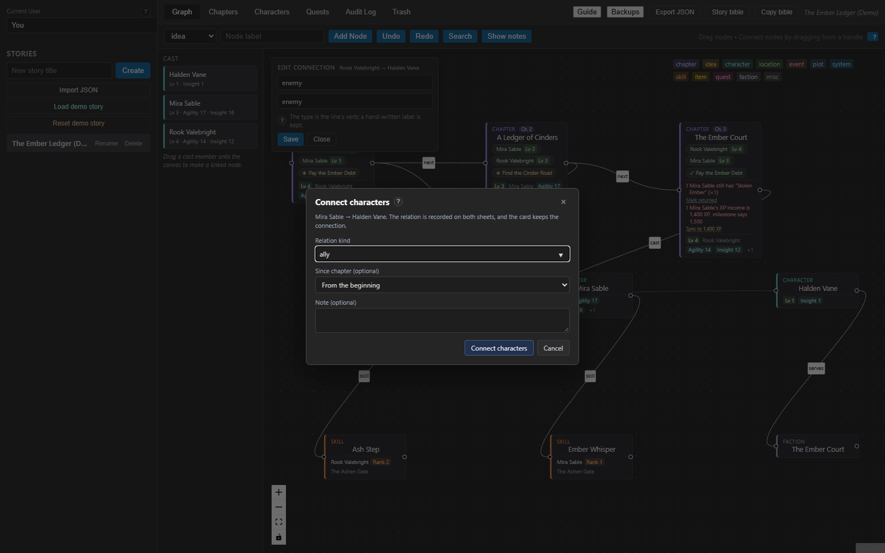

*Dragging from Mira's handle to Halden Vane's opens the relation form. The dialog
says what is about to be true — "the relation is recorded on both sheets, and the
card keeps the connection" — because two rows are about to be written.*

Submitting it runs `createGraphEdge` and `addRelation` in that order, and if the
relation is refused the edge is deleted again so the board never keeps a bond the
ledger does not have. Undo is one step: it removes the relation *and* the line.

### Reading a card's numbers

Clicking any card opens the inspector drawer. For a character card it shows the
linked cast member's level, XP and stats, and lets them be edited in place:

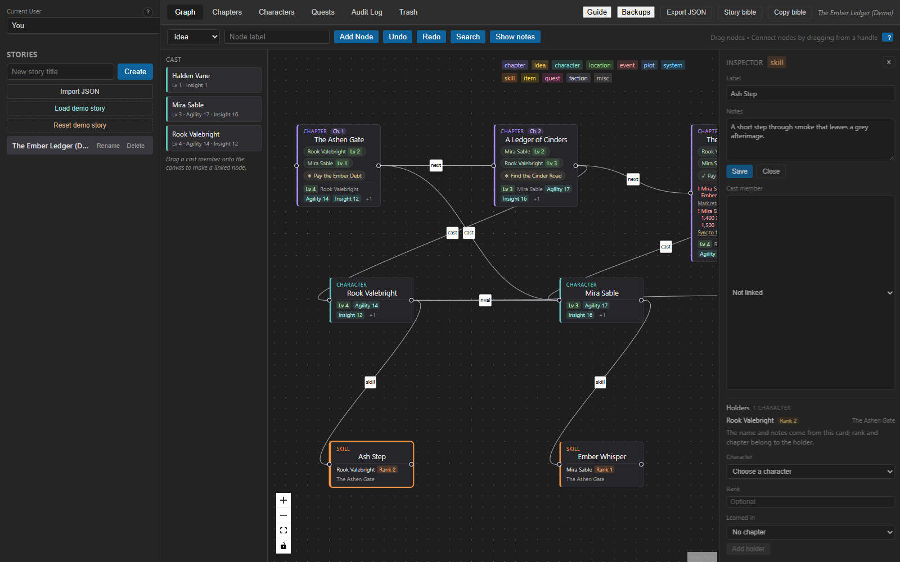

*The inspector for the **Ash Step** skill card: label and notes, the cast member
the card is linked to, and — because this is a skill card — the holders it already
has and the form that adds one.*

The inspector's numbers come from `useCanvasInspector`, which is handed the
character's stats and attributes for the card that is open. Editing a stat there
writes `set_character_stat`, the same command the sheet uses, so the two views
cannot disagree.

### Clicking a line instead of a card

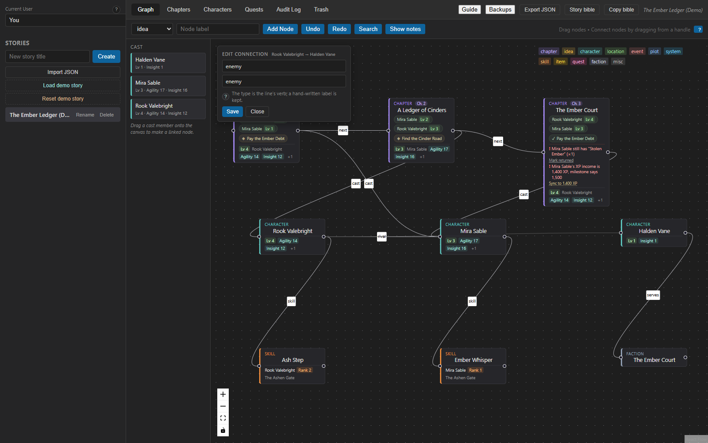

*A connection opened in its own editor: the label and the relation type, both
freely editable. The `?` beside the heading explains that the type is the line's
verb, while the label is the author's own words.*

Renaming a line's relation type is a plain `update_graph_edge`. Changing or
removing a **domain** connection — a relation line, a cast line, a skill line — is
not: deleting it prompts to remove the record behind it (see
[Workflow D](#7-workflow-d--history-the-audit-log-and-the-trash)), because a line
that is only a drawing never was.

---

## 5. Workflow B — a skill card, its holders, ranks and chapters

*Goal: create a skill, decide who holds it, and fix a rank for one holder — and
watch the card stay one identity across both sheets.*

### Creating the card

Pick **skill** in the canvas toolbar's type list and press **Add Node**. That opens
the full card form rather than a label-only card, because a skill is the kind of
card that has a record behind it. The form's **owner** field is optional: a skill
may be placed on the board before anybody holds it, and a character joins later by
connecting their card to it or by using the card's own holder form. Submitting runs
`createGraphNode` and, only when an owner was chosen, `add_skill` — one step,
`Add "<name>"`, whose undo deletes the hold and then the card.

Dragging a connection from a character card into empty canvas does the same thing
with the form pre-filled: with **skill** selected, the character becomes the
skill's owner. (Dragging off a *chapter* card fills the chapter field instead, and
off a character card with **quest** selected fills the quest's giver.)

### The card's holders

Opening a skill card and using the form at the bottom of the inspector adds a
holder:

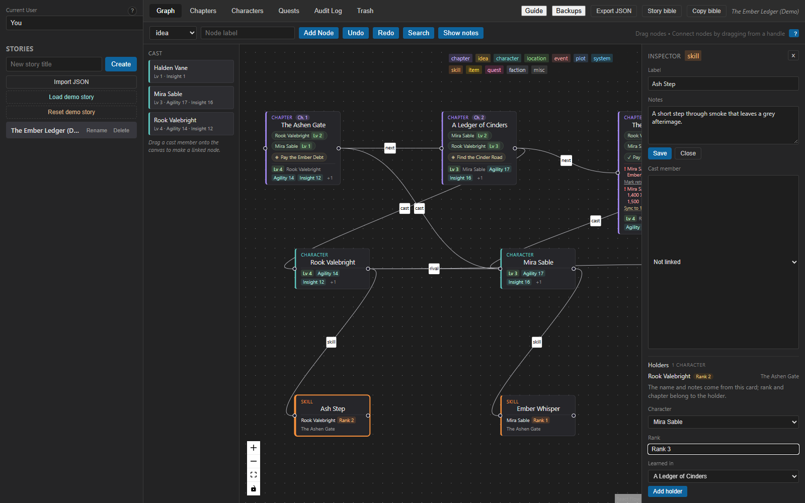

*Adding a second holder to **Ash Step**: choose the character, give them a rank,
say which chapter they learned it in. The card's own notes supply the effect, so
the form never asks for the skill's words — the card is where those live.*

The write is one `add_skill(characterId, name, rank, effect, chapterId, nodeId,
actor)` call, with the card's id as `node_id`. That link is what makes the card and
the sheet the same thing:

- the **name and effect** come from the card,
- the **rank and chapter** belong to the holder and are stored on their row,
- the sheet shows them under **Skills**, with the card's name as a link back to the
  board.

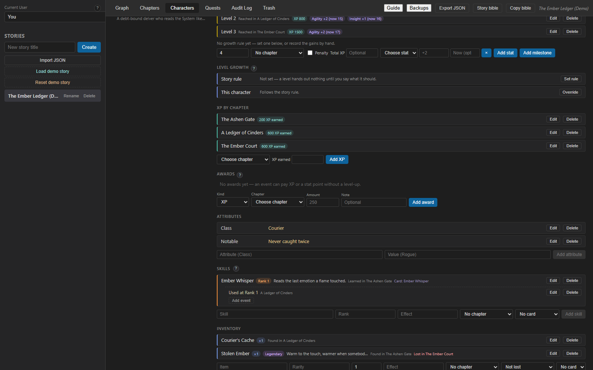

*Mira's sheet: XP by chapter, attributes, the skill she holds with the event that
used it and the card it came from, what she carries, and her currency. Each row is
editable in place, and every write answers whether the row was written — so a form
closes only on a save that happened.*

### The cascade, and why it is one step

Renaming the **Ash Step** card rewrites the name on Rook's own skill row, because a
card is the shared identity. On the Rust side that is `sync_skill_card_holders`,
called from `update_node` inside the same transaction as the card's own update —
and re-run when a *revert* puts an old label back, so a sheet can never keep a
value the card no longer has. On the canvas side the app lists the same correction
as one step, so one Undo restores the card *and* every holder.

Deleting goes the other way: deleting a skill from a sheet removes the canvas line
that put it there (`matchingSkillEdge`), so the board cannot keep a connection to a
hold that no longer exists. Inside that write the database cascades the row's own
history — its events and its evolution links — and the app keeps a copy of them so
the step can be undone whole.

### The tree

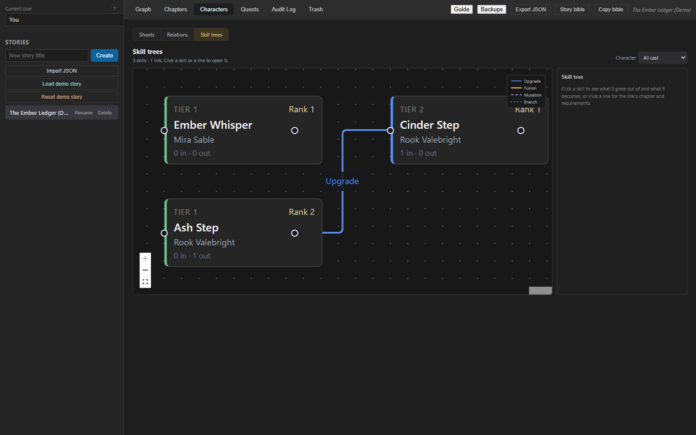

*The **Skill trees** view: skills as tiers, each link a kind — upgrade, fusion,
mutation or branch. The right panel explains the selected link's chapter and
requirement.*

The tree is built from `skill_evolutions` links, each naming a parent, a child, a
kind, a chapter and the rank the author says the parent needed. The link form
refuses a parent and child that would close a loop, and the refusal is worked out
in `src/domains/skills/evolution.ts` so the form can show it *before* the write —
the database refuses it too, because the rule is not the UI's to keep.

---

## 6. Workflow C — chapters on the sheet and on the board

*Goal: keep the reading order, the cast and the notes in step with the cards on the
board.*

A chapter exists twice, on purpose: it is a **card** on the Graph tab and a **row**
in the reading order on the Chapters tab. They are the same row — `nodes` with
`node_type = 'chapter'` — which is why renaming a chapter card renames the chapter
in the list.

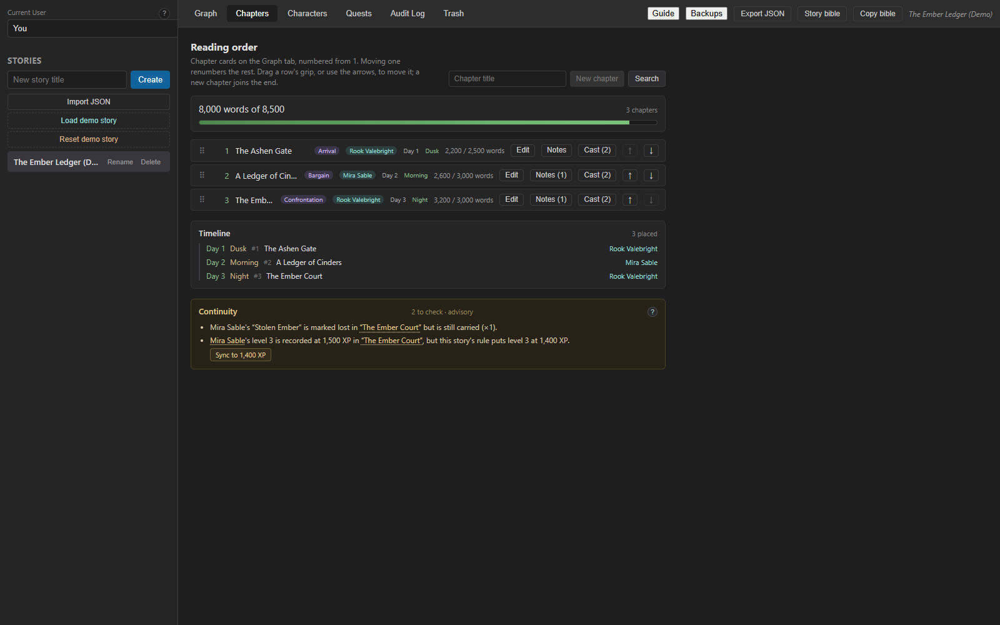

*The Chapters tab for the sample story: the word budget across all chapters, the
reading order with each chapter's arc, POV, day and time, the **Timeline**, and the
**Continuity** panel. Two advisories are raised here, and both are real: the
chapter's card in the graph showed them too.*

What the tab does with that row:

- **Reading order** is `chapter_seq`. Moving a chapter renumbers the ones between
  it and its destination, and each chapter whose number changed gets its own audit
  entry, so the history explains the whole new order rather than only the card that
  was dragged. `set_chapter_order` writes the order and answers with the renumbered
  chapters, so a refused list leaves the board as it was instead of half-renumbered.
- **Arc, POV, day, time, word counts** are `set_chapter_details`, and a chapter
  made after an upgrade simply has none of them, which is different from a word
  count of zero.
- **The cast** is asked of the database, which decides who is assigned from three
  things at once: the chapter's *linked* cast member, its point of view, and the
  explicit rows in `chapter_cast`. Those rows are what the card's cast badges and
  the "as of chapter" snapshot are built from. Connecting a character card to a
  chapter card runs `add_chapter_cast_member` and then `createGraphEdge` — and puts
  the cast member back if the edge cannot be saved, because the cast change would
  otherwise be an invisible edit.
- **Continuity** is worked out in `App.tsx` from the loaded rows, not in the
  database: a chapter's XP ledger against its milestone, an item marked lost but
  still carried, a point of view nobody else shares, a time without a day. Each
  advisory names the chapters or cast it is about, so clicking one opens the sheet
  or the row that needs editing.

### Notes

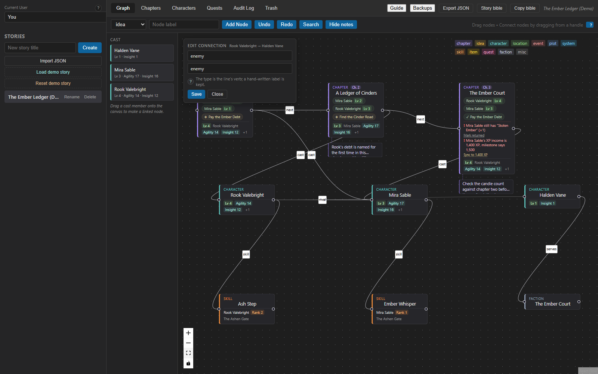

*Turning **Show notes** on draws each chapter's notes as small cards beside the
board. Clicking one is a way into the note, not a second copy of it: the Chapters
tab opens with that chapter's notes showing and the note lit.*

A note is stored as a node with `parent_node_id` pointing at its chapter, which is
why deleting one is the board's own `delete_node` — it goes to the trash like a
card, and the panel can drop the row knowing the database has not forgotten it.

---

## 7. Workflow D — history, the audit log and the trash

*Goal: reverse a mistake, and know what happened when the reversal is refused.*

### Undo, in one sentence

Undo walks the stack of whole actions recorded by `useHistory`; the label appears
in the top bar, and the board is read back from the database afterwards rather
than patched. Redo walks forward again. `Ctrl+Z` and `Ctrl+Shift+Z`.

### The audit log

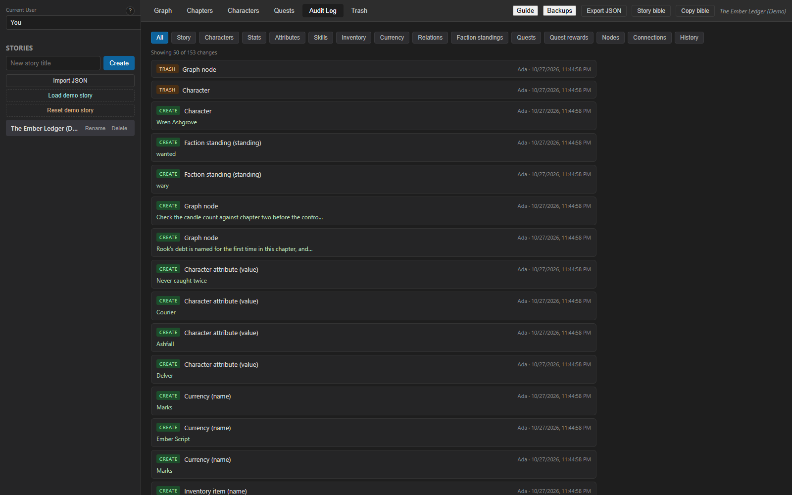

*The Audit Log for the sample story: 141 changes, filterable by the kind of thing
that changed, newest first, each row naming the value it wrote and who wrote it.*

The log is the durable record, and it is written by the database rather than by the
UI: every mutating operation writes its entry inside the same transaction as the
change. In the tab you can filter by entity type, extend one page of 50 at a time,
and **Revert** a field — but only when that field still holds the value the entry
recorded. That check is derived when the page is read, by the same function
`revert_change` runs before writing, so the button can never offer a revert the
engine would refuse. A revert is itself an edit: it writes its own entry holding
the value it replaced.

The tab also carries the app's own honesty notes: `undo_refused`, `redo_refused`
and `step_rolled_back` are written by `recordHistoryEvent` when a step could not be
walked back, so a half-finished action leaves a permanent line instead of a notice
that fades.

### The trash

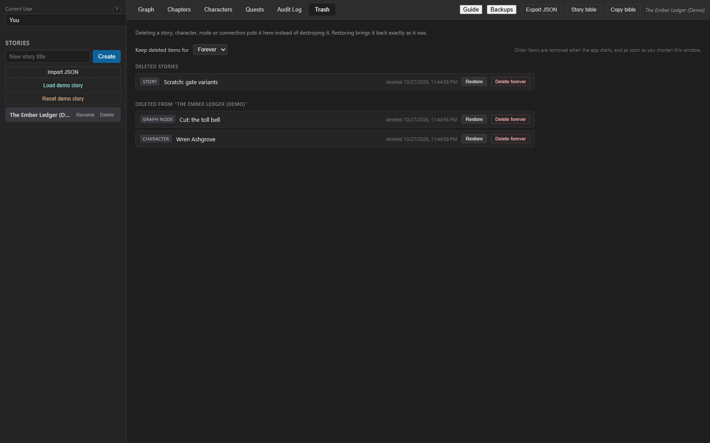

*The trash lists two different things under one command: the stories that were
deleted (read with no story named) and the rows deleted inside the open story
(read with one). Both have **Restore** and **Delete forever**.*

Deleting a story, character, node or connection sets `deleted_at` instead of
destroying anything, and the reads that feed the app filter those rows out. The
retention window (**Keep deleted items for**) is what empties the list afterwards:
`set_trash_retention` applies the window immediately and answers with how many rows
it swept, and the desktop crate applies the same window at launch, before the app
window exists.

One consequence is worth knowing as an author: the trash is the *only* undo that
survives an undo stack, and the launch snapshot (`snapshots/`, beside the database,
listed by **Backups**) is the only undo that survives the database itself. The
audit log records what changed, not what the row held: a deleted character leaves
its name behind, not its description.

---

## 8. Where to change what

| You want to… | Start at |
| --- | --- |
| Add a card type, colour or caption | `src/domains/canvas/types.ts` (`nodeTypes`) and `.graph-node` rules in `src/styles.css` |
| Change what a connection does | `onConnect` / `onConnectEnd` / `dropCastMember` in `src/App.tsx`, then the api function it calls |
| Change what a card's drawer shows | `src/domains/canvas/GraphTab.tsx`, and `GraphNode.tsx` for the card itself |
| Move state out of `App.tsx` | The `src/domains/<domain>/` folder for that tab, following `useChapterWorkspace` or `useCanvasDrafts` |
| Add, rename or re-shape a command | `src/domains/<domain>/api.ts` and its `#[tauri::command]` wrapper in `src-tauri/src/lib.rs` |
| Change a query, a cascade or an audit entry | `src-tauri/db/src/lib.rs`, in the `Db` method that owns it |
| Change the history, its notices or its refusals | `src/domains/history/useHistory.ts` |
| Change a tab's panel | `src/domains/<domain>/<Panel>.tsx`; the panel takes props and keeps only what nothing else uses |
| Change this guide | `GUIDE.md` itself, which is what the app reads; how it is read is `src/domains/guide/` |
| Change the demo story, or what the pictures show | `seed_demo_story` in `src-tauri/db/src/lib.rs`, which builds the story `npm run screenshots` photographs |

Verification, after any of the above:

```bash
npx tsc --noEmit                  # types
npm test                          # 704 frontend tests (vitest, jsdom)
npm run build                     # tsc + the production bundle
cd src-tauri && cargo test -p litrpg-db   # 184 database tests
cd src-tauri && cargo fmt --check
npm run screenshots               # the guide's pictures, and the check that none drifted
```

The frontend suite renders the real `App` with `invoke` mocked, so it covers what
the Rust tests cannot see: what a tab requests, what it does with a page that
arrives late, and what it says when a filter matches nothing. Several panels also
have a direct-render suite of their own — the quest ledger, the Chapters tab, the
trash, the sheet, the graph tab and most of the domain hooks — which is the faster
place to test a change in one panel.

---

## 9. Visual asset checklist

Every anchor point named while planning this guide, and the file each one became.
All of them are in [`screenshots/`](screenshots/) and are images of the running app.

| # | Anchor point | Workflow | File |
| --- | --- | --- | --- |
| 1 | First-run welcome card | Mental model | [`screenshots/onboarding-welcome.png`](screenshots/onboarding-welcome.png) |
| 2 | Graph tab: cards, labels, cast rail, legend | C | [`screenshots/canvas-board.png`](screenshots/canvas-board.png) |
| 3 | Node inspector drawer, with the skill holder form | A, B | [`screenshots/card-inspector.png`](screenshots/card-inspector.png) |
| 4 | Holder form filled in on a skill card | B | [`screenshots/skill-holder-form.png`](screenshots/skill-holder-form.png) |
| 5 | Connection editor for a drawn line | A | [`screenshots/connection-editor.png`](screenshots/connection-editor.png) |
| 6 | Relation dialog between two character cards | A | [`screenshots/relation-popover.png`](screenshots/relation-popover.png) |
| 7 | Chapters tab: reading order, timeline, continuity | C | [`screenshots/chapters-tab.png`](screenshots/chapters-tab.png) |
| 8 | Character sheet, upper half: curve, progression, milestones | A | [`screenshots/character-sheet.png`](screenshots/character-sheet.png) |
| 9 | Character sheet, lower half: XP, attributes, skills, items | B | [`screenshots/character-sheet-detail.png`](screenshots/character-sheet-detail.png) |
| 10 | Relations and faction standings map | A | [`screenshots/relations-map.png`](screenshots/relations-map.png) |
| 11 | Skill tree with an evolution link | B | [`screenshots/skill-tree.png`](screenshots/skill-tree.png) |
| 12 | Quest ledger with rewards and the apply button | — | [`screenshots/quest-ledger.png`](screenshots/quest-ledger.png) |
| 13 | The board's form for making a quest card | — | [`screenshots/quest-form.png`](screenshots/quest-form.png) |
| 14 | The search palette with a word typed | — | [`screenshots/search-palette.png`](screenshots/search-palette.png) |
| 15 | Audit log with filters and entries | D | [`screenshots/audit-log.png`](screenshots/audit-log.png) |
| 16 | Trash: deleted stories and deleted rows | D | [`screenshots/trash-tab.png`](screenshots/trash-tab.png) |
| 17 | The author's guide read in the app, pictures and all | — | [`screenshots/in-app-guide.png`](screenshots/in-app-guide.png) |
| 18 | Board with chapter notes shown | C | [`screenshots/canvas-notes.png`](screenshots/canvas-notes.png) |

An anchor point with no picture, and why: **a drag in progress** — a cast name held
over the board, or a connection being pulled out of a card's handle. A screenshot
of a gesture shows a still of something the reader is about to do with their own
hand, so the guide describes the two gestures in words instead (the cast rail's
drop targets, and the empty-canvas drop that opens a pre-filled form) and shows
the state they produce.

### How the pictures were taken

Not with a second UI. `tools/screenshots/` renders `src/App.tsx` in a browser page
with the four Tauri modules aliased to a small in-memory backend, which serves the
story in `fixture.json` — and that file is written by the database crate's own
example, `src-tauri/db/examples/screenshot_fixture.rs`, so every row has the shape
the desktop build sends.

The story is the demo story itself. `seed_demo_story` in `src-tauri/db/src/lib.rs`
builds the cast, the chapters, the board and its connections, the quests, the loot
and the rows waiting in the trash, and the app seeds it from **Load demo story** —
the example only writes down what the database then answers. So the story pictured
here is the story you can open and click, and a picture that no longer matches the
app means the app changed, not that the harness drifted.

This document is read in the app as well: `src/domains/guide/` renders `GUIDE.md`
and the pictures beside it where the header's **Guide** button can open them.

To regenerate the story and every picture above in one step, run
`npm run screenshots`. The run shoots each anchor, then compares what it shot with
the images this guide links and fails if the two lists differ, so the gallery
cannot quietly drift from the app it documents.
[`tools/screenshots/README.md`](tools/screenshots/README.md) has the detail.
Nothing in `tools/` is part of the app: `npm run build`, `npm test` and the Tauri
bundles do not read it.
