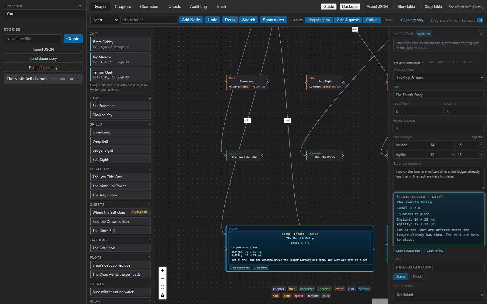

# How It Works — an illustrated guide

This is the walkthrough for the *LitRPG Storyboard Tracker* engine: what happens
between drawing a line on the canvas and finding a row in the database, which
module owns which part of that trip, and what four ordinary pieces of work look
like end to end.

It is written for whoever changes the app:

- **Developers** who have to change it — the domain boundaries, the command
  names, and where a new feature belongs.
- **Anyone** who wants to know why the app behaves as it does — why a skill rename
  reaches every sheet, why a connection is not "just a line".

**If you are here to use the app rather than to change it, read
[`STORYBOARDING.md`](STORYBOARDING.md) instead.** That is the author's guide: what
to click, in what order, to plot a story and keep its numbers straight, with the
same pictures. It is what the header's **Guide** button opens in the app, and this
document is what happens underneath it.

For the schema, the audit model and the data location,
[`README.md`](README.md) is the reference and is not repeated here.

The screenshots are of the real app, rendered against a sample story — see
[How the pictures were taken](#how-the-pictures-were-taken).

---

## Contents

1. [The mental model](#1-the-mental-model)
2. [One change, all the way down](#2-one-change-all-the-way-down)
3. [The domains and how they relate](#3-the-domains-and-how-they-relate)
4. [Workflow A — a cast member, a card, and their numbers](#4-workflow-a--a-cast-member-a-card-and-their-numbers)
5. [Workflow B — a skill card, its holders, ranks and chapters](#5-workflow-b--a-skill-card-its-holders-ranks-and-chapters)
6. [Workflow C — chapters on the sheet and on the board](#6-workflow-c--chapters-on-the-sheet-and-on-the-board)
7. [Workflow D — history, the audit log and the trash](#7-workflow-d--history-the-audit-log-and-the-trash)
8. [Where to change what](#8-where-to-change-what)
9. [Visual asset checklist](#9-visual-asset-checklist)

---

## 1. The mental model

Three rules explain almost every behaviour in the app. They are the same three the
first-run card lists in one line each, and the same three
[`STORYBOARDING.md`](STORYBOARDING.md) closes with. (That is the document the app's
**Guide** button opens — the author's guide. This one is for whoever is changing
the code, and it starts by explaining the same three rules from the inside.)


*The first-run card. **Open the guide** opens this file where it is read; the card
itself lists the three rules one line each and then gets out of the way.*

**1. The canvas is a database.** A card is a row; a connection is a row. Drawing a
line between two character cards does not decorate the board, it writes a
`character_relations` record and an audit entry. Connecting a character to a
chapter writes a `chapter_cast` row. Connecting a character to a skill card gives
that character the skill.

**2. A skill card has one identity.** A skill's name, rank and effect belong to
the skill, not to the card or to one holder. Editing a card's label or notes
rewrites every holder's row in the same transaction, which is why a correction
made in one place appears on every sheet that holds it — as one undo step.

**3. History goes back whole actions.** One save is one step, even when it touched
a card and a sheet together. Undo and Redo walk those steps; the Audit Log keeps
the longer record of who changed what, with a Revert on each field.

Underneath those three rules is one more idea that shapes the code: **the UI never
decides a domain fact.** Whether a bond is symmetric, whether two skills may
evolve into each other, whether a chapter's XP adds up, what a sheet held at
chapter 2 — the database answers, and the UI shows the answer.

---

## 2. One change, all the way down

Every write travels the same five stages, in this order.

```
   ┌─────────────────────────┐
   │ src/domains/canvas/     │   React Flow board, cards, cast rail,
   │   GraphTab.tsx          │   drawers, dialogs          ("the view")
   │   GraphNode.tsx         │
   └───────────┬─────────────┘
               │  a handler: drop, click, submit
   ┌───────────▼─────────────┐
   │ a domain hook           │   useCanvasDrafts · useCanvasInspector
   │ src/domains/<d>/*.ts    │   useSkillHolderForm · useChapterWorkspace
   │                         │   useHistory · useSheetStats …
   └───────────┬─────────────┘
               │  an intent, with the facts it needs
   ┌───────────▼─────────────┐
   │ src/domains/<d>/api.ts  │   the ONLY place a command name, its
   │                         │   arguments and its answer type exist
   └───────────┬─────────────┘
               │  invoke('set_node_character', { nodeId, characterId, user })
   ┌───────────▼─────────────┐
   │ src-tauri/src/lib.rs    │   106 #[tauri::command] wrappers:
   │                         │   camelCase in, snake_case through, String errors out
   └───────────┬─────────────┘
               │  a Db method call
   ┌───────────▼─────────────┐
   │ src-tauri/db/src/lib.rs │   one transaction: the row(s), a renumbering,
   │                         │   the cascade — and the audit entry beside them
   └───────────┬─────────────┘
               │  the row it wrote
   ┌───────────▼─────────────┐
   │ React state in App.tsx  │   and the tab panel that reads it re-renders
   └─────────────────────────┘
```

Three properties of that pipeline are worth stating plainly, because a lot of the
code is there to keep them true.

**The command layer is the only door.** `@tauri-apps/api/core`'s `invoke` is
called in exactly one kind of file — `src/domains/<domain>/api.ts`. There is no
`invoke` anywhere else in `src/` outside the tests. So the answer to "what does
this button write?" is always one function away, and the answer to "who calls this
command?" is a grep in one directory. The frontend names 98 distinct commands; the
desktop crate registers 106 handlers.

**The audit entry is written with the change, not after it.** If the entry cannot
be written the change is rolled back rather than committed unattributed. That is a
database-layer guarantee (`log_audit` inside the same transaction), so no UI path
can forget it.

**The app re-reads rather than guesses.** After an undo, a revert from the audit
log or a story switch, the board and the panels are read again from the database
instead of being patched in memory. `reloadStory` and `loadStory` in `App.tsx` are
the two places that do it, and they exist because a restored row brings its
connections with it — a fact no local patch can know.

### What a "step" is

Undo is a stack of steps, not a stack of rows. `src/domains/history/useHistory.ts`
holds the two stacks and each step is `{ label, undo, redo }` — a label for the
notice ("Add holder", "Relink 'The Low Tide'") and the two writes that walk it
back and forward. The rules that make it feel reliable:

- **A step is recorded only after the write succeeded.** A refused write leaves
  no step behind, so pressing Undo can never "undo" something that did not happen.
- **One gesture is one step** even when it wrote two rows: a relation and its
  connection, a cast member and its connection, a card and the row behind it.
- **A step that could not finish is put back whole.** The half that had already
  been written is deleted, and the attempt is written into the Audit Log as
  `step_rolled_back` rather than left to a fading notice.
- **A refusal is a fact about the story.** An Undo or Redo the database refuses is
  recorded as `undo_refused` / `redo_refused`, with the reason.
- **Undo is scoped to the open story.** Switching stories forgets the stacks,
  because an undo that reached across a story switch would be editing a board the
  author is no longer looking at.
- **Undo does not touch unsaved typing.** An open drawer follows the stored row
  unless it holds text the author has not saved (`useCanvasDrafts` keeps the dirty
  flags and the half-written text remembered per card).

---

## 3. The domains and how they relate

`src/App.tsx` is the orchestrator: it owns the open story, the loaded rows, the
handlers and the tab layout. Everything that does not need all of that lives in a
domain folder beside it.

```
src/
├── App.tsx                     the story, the rows, the handlers, the tab layout
├── components/                 shared widgets (HelpTip, SuggestionInput, view toggle)
├── lib/format.ts               small formatting helpers
└── domains/
    ├── shared/                 row types more than one domain reads
    ├── canvas/                 board, cards, cast rail, drafts, inspector, holder form
    ├── narrative/              chapters, their cast, their notes, the chapter logic
    ├── characters/             the sheet: stats, attributes, items, currency, bonds
    ├── skills/                 the skill section, the tree and its loop guard
    ├── quests/                 the ledger: quests, rewards, apply-to-ledger
    ├── progression/            XP, levels, milestones, the power curve
    ├── relations/              the cast map and the faction standings
    ├── inventory/              items and currency commands (the sheet draws them)
    ├── audit/                  the history tab, its filters and its rows
    ├── trash/                  the two deleted lists and the retention window
    ├── stories/                the shelf: rename, delete, import, export, backups
    ├── search/                 the Ctrl+F palette over the board and other stories
    └── history/                the undo and redo stacks
```

| Domain | Owns | Reads and writes through |
| --- | --- | --- |
| **canvas** | The board, the card, the cast rail, the connection editor, the inspector drawer, which card or line is open, the drafts typed into a drawer, and the skill card's holder form | `get_graph_nodes`, `get_graph_edges`, `create_graph_node`, `update_graph_node`, `set_node_character`, `create_graph_edge`, `update_graph_edge`, `delete_node`, `delete_edge`, `add_skill` (a holder) |
| **narrative** | Chapters: reading order, arcs, POV, day and time, word counts, the cast on a chapter, its objective checklist, the notes under it, and the continuity advisories the chapter cards raise | `set_chapter_order`, `set_chapter_details`, `get_story_chapter_cast`, `get_story_chapter_cast_states`, `add_chapter_cast_member`, `get_story_chapter_tasks`, `add_chapter_task`, `set_chapter_task_done`, `add_chapter_note`, `update_chapter_note` |
| **characters** | The sheet's sections — attributes, stats, items, currency, bonds, faction standings, level rows and XP by chapter — each keeping its own open row and draft fields | `get_character_stats`, `set_character_stat`, `get_character_attributes`, `get_character_inventory`, `get_character_currency`, `get_character_state_at_chapter` |
| **skills** | The skill section on a sheet, what a level-up did to a skill (`used`, `upgraded`, `sacrificed`), and the evolution tree with its cycle guard | `add_skill`, `update_skill`, `delete_skill`, `add_skill_event`, `add_skill_evolution`, `get_story_skill_evolutions` |
| **quests** | The ledger: quest drafts, reward drafts, the status filter, the apply notices, the card each quest stands for, and the continuity warnings a payout raises | `get_story_quests`, `add_quest`, `update_quest`, `link_quest_card`, `add_quest_reward`, `mark_quest_rewards_applied` |
| **audit** | One page of history, the entity filter, the extendable window, and the revert notices | `get_audit_history`, `revert_change`, `record_history_event` |
| **trash** | Both deleted lists (the open story's, and the stories themselves), which row is waiting on a permanent-delete confirmation, and the retention window | `get_trash`, `get_trash_retention`, `set_trash_retention`, `restore_deleted`, `purge_deleted` |
| **progression** | The power curve: which metric, which cast members are shown, the chapter the sheet is read as of, the whole sheet — stats, skills and carried items — that chapter opens, what a level hands out, and the gains that skipped a level-up | `get_story_levels`, `get_story_level_growth_rules`, `get_story_character_awards`, `get_story_character_progress`, `get_character_state_at_chapter` |

Experience, the level and the target are three numbers with one owner each, and
none of them can be typed. `characters.xp` is the sum of the `character_progress`
rows, the level is what the story's curve buys with that sum, and `xp_to_next` is
the next step of the same curve. All three are rewritten by one function,
`refresh_character_progression`, called in the same transaction as every write
that changes the income — adding, editing or deleting a chapter's amount, an XP
award, or the curve itself — so the sheet, the cast rail, the cards and the
exports cannot disagree with the ledger.

A level that is reached is written down as it happens: the same call inserts the
timeline row (the level, the chapter whose income crossed it, the running total)
and posts the rule's automatic stats to the sheet as real `character_stat_changes`
rows. Deleting the income reverses both, so no level survives without an entry
behind it. The only thing authors still type about progression is the rank. A
timeline row recorded before the curve existed keeps its level as a floor rather
than a rival: `source` on the row says which is which, and the level is the greater
of the curve's answer and the recorded one.

The arrows between domains all pass through `App.tsx`. A chapter card asking for a
cast member's level reads the rows `App.tsx` already loaded; the quest ledger
handing a payout to the sheet calls back into the app's setter. No domain imports
another domain's state, and `src/domains/<domain>/api.ts` is the only file that
knows a command name.

On the Rust side there are two crates, and the split is the reason the database
can be tested without a window:

- **`src-tauri/db`** — `Db`, the migrations, every query, the audit log and the
  launch snapshots. In-memory SQLite drives 184 tests.
- **`src-tauri/src`** — the Tauri commands: thin wrappers that map camelCase
  arguments to the snake_case parameters, turn errors into strings, and register
  the 106 handlers.

---

## 4. Workflow A — a cast member, a card, and their numbers

*Goal: get Ivy onto the board as a card that is linked to her sheet, then read
her numbers without leaving the canvas.*


*The Graph tab, on the demo: six chapter cards in reading order, each one a
workbench with its summary, its roster with a level *as of that chapter*, its
objective checklist, **Cast** and its **Progression & Events** ledger, then its own
continuity warnings. **+ Event** on the card logs one scene event — XP, a learned
skill, a rank-up, an evolution, a sacrifice or an acquired item — and under those
lines the ledger mirrors the skills the sheets place in the chapter, each tagged
**sheet**. The cast rail is on the left; the three character cards sit under the
chapters, and around them is one card of every other type the canvas draws: four
skills, two quests, a faction, three locations, two items, two plot cards, the
System, an event, two ideas and a note card. The lines are named: `next` between
chapters, `ally` / `rival` / `owes` between two characters, `serves` into the
faction, `quest` from the chapter that took one on, `happens in` from a scene to
its place, `holds` from a character to the item they carry. A line that only
repeats what a badge or a sheet already holds — a cast assignment, a skill hold —
is the faint dashed thread with no verb, still clickable when the wiring itself is
what you came to change.*

Every write on that card face leaves through `App.tsx` and records one history
step. **Cast** writes a `chapter_cast` row through `add_chapter_cast_member` (or
takes one back with `remove_chapter_cast_member`), and the point of view is a
column written with `set_chapter_details`. **Add** and the objective checkboxes
write `chapter_tasks` rows with `add_chapter_task` / `set_chapter_task_done`.

Under the logged events the card also mirrors the skills the sheets place in this
chapter. `App.tsx` derives those rows with `sheetSkillsByChapter`: every live skill
whose `chapter_id` is this chapter, minus any skill an event on the chapter already
names (its `source_id`, `skill_id` or `new_skill_id`), handed to the card as
`chapterSheetSkills`. They are drawn with a **sheet** tag, cannot be removed from
the card, and follow the sheet live — adding, renaming, re-ranking, re-chaptering or
deleting a skill on the Characters tab changes the card's ledger without a second
write, and without a `chapter_events` row of its own.

**+ Event** calls `add_chapter_event`, which writes one `chapter_events` row
(schema v34) and, for XP, a learned skill or an acquired item, the award, skill or
inventory row it stands for. A rank-up, evolution or sacrifice names a
`character_skills` row: the rank-up raises it and writes an `upgraded` skill event,
the evolution creates the new skill with an `skill_evolutions` mutation link (and a
`sacrificed` event for the base when **Keep the base skill** is off), and the
sacrifice writes a `sacrificed` event or deletes the row. The chapter event keeps
the ids and the old rank it wrote, so `delete_chapter_event` puts the sheet back.
The app then reads the skills, cast, levels and stats back, so the badges on every
other card follow in the same render. None of these are board-only facts: the same
rows are what the Chapters tab, the skill tree and the sheet show.

### The easy route: drop a cast member on the board

1. **Drag a name out of the cast rail.** `GraphTab` puts the character's id in the
   drag payload under `CAST_DRAG_TYPE`, so the drop knows whose drag it is before
   any state catches up.
2. **Drop it on empty canvas** → `dropCastMember` in `App.tsx` calls
   `createGraphNode(…, 'character', name, null, x, y, actor, characterId)`. One
   command creates the card *and* its link, so a refused link leaves nothing
   behind. The new card opens immediately, because the drop is not finished until
   the numbers are visible.
3. **Drop it on an existing card instead** → `set_node_character` points that card
   at the member. `App.tsx` records one step, `Relink "<card>"`, whose undo puts the
   previous link back and whose redo restores this one. If the card's label was the
   *old* member's name, the app offers the rename rather than taking it — the label
   is the author's.

### The same thing with a connection

Dragging from a card's handle to another card is the canvas gesture; what it does
depends on what the two ends are. Between two character cards it asks for the
relation first:


*Dragging from Ivy's handle to Tamsin's opens the relation form. The dialog
says what is about to be true — "the relation is recorded on both sheets, and the
card keeps the connection" — because two rows are about to be written.*

Submitting it runs `createGraphEdge` and `addRelation` in that order, and if the
relation is refused the edge is deleted again so the board never keeps a bond the
ledger does not have. Undo is one step: it removes the relation *and* the line.

### Reading a card's numbers

Clicking any card opens the inspector drawer. For a character card it shows the
linked cast member's level, XP and stats, and lets them be edited in place:


*The inspector for the **Brine-Lung** skill card: label and notes, the cast member
the card is linked to, and — because this is a skill card — the holders it already
has and the form that adds one.*

A chapter card's drawer is the exception: a chapter names its people through its
point of view and its cast rows, so the drawer lists that roster — each name
opening that sheet as of the chapter — with a button to the Chapters tab and no
single-cast picker at all. Linking one name on the card was the second, redundant
binding this roster replaced.

The inspector's numbers come from `useCanvasInspector`, which is handed the
character's stats and attributes for the card that is open. Editing a stat there
writes `set_character_stat`, the same command the sheet uses, so the two views
cannot disagree.

### The card and the record

A card is one of two things, and the drawer says which. For a person, a quest, a
skill or an item it is a *view*: the record lives in `characters`, `quests`,
`skill_definitions` and `character_inventory`, and the card is the face it wears on
the board. For a chapter, a location, a plot, an idea, an event, a faction or a
note there is no second table — the card *is* the record, which is what
`cardOnlyNote` in `src/domains/canvas/types.ts` says in the drawer, so an author
does not go looking for a form that never existed.

The kinds with a record behind them are joined by id rather than by name, because a
name match breaks the first time either side is renamed:

| card | its record | the link |
| --- | --- | --- |
| character | `characters` | `nodes.character_id` |
| quest | `quests` | `quests.card_node_id`, written by `link_quest_card` |
| skill | `skill_definitions` | `skill_definitions.node_id` |
| item | `character_inventory` | `character_inventory.node_id` |

Two columns point the other way, *at* a card, because a faction has no table of its
own: `quests.faction_node_id` and `faction_standings.node_id` both hold a `faction`
node's id. That is why the ledger draws a quest's faction as a button and not as
text — it calls the same `onOpenCard` the **Card:** chip does — and why the card's
drawer lists the quests issued from it (`factionQuests`, built once in `App.tsx`
from `storyQuests` and handed to the card as data) with an `onOpenQuest` chip back
into the ledger. A faction card in the Trash reads as **faction in the trash**, and
a purge clears the columns through `ON DELETE SET NULL`.

`quests.card_node_id` is new in schema v35 and was back-filled once, from the label
match the board had been relying on, so a story written before it keeps the pairing
it was already drawing. The column is `ON DELETE SET NULL` for a purge and left
alone by a delete, because a trashed card keeps the link: the ledger then says the
card is **in the trash** and a restore puts the chip back. A partial unique index
(`idx_quests_card`) makes one card stand for one quest, and `link_quest_card`
refuses a card of another kind or one another quest already claims. The link is
never written by `add_quest`: a quest made in the ledger has no card until the board
places one, and that is a state the ledger shows rather than papers over.

### The System's box

A `system` card is not a note with an outline: it is the announcement a reader
meets, and what it is announcing decides what it needs — a level that moved, a
quest's objectives, a skill's evolution. The feature is three files, and the reason
there is no migration behind it is the format in the first one.

- `systemMessage.ts` holds the shape. `SystemMessage` has every kind's fields on
  it, `systemMessageOf(label, content)` reads a card into one, and
  `serializeSystemMessage` writes it back into `nodes.content`. The card still
  stores text: the **label** is the header and the notes are the message under the
  small line format below.
- No new column, so one Save is still one `update_node` and one history step, and
  Undo takes the whole box back. A card written before the format — a title on the
  first line, the body under it — reads as a `notice`, which is what it was, and the
  first edit converts it.

```
Type: level_up
Title: The Tide Advances
Level: 3 → 4
Points: 2
Stat: Agility | 12 → 13
---
Flavour text, any length.
```

- `systemBlocks(message)` is the body as blocks of `SystemLine`s: a line is `text`
  with an optional `strong` (a heading, a stat, a checklist row) or a `label` whose
  rest stays plain (`Rewards:`). A block is the lines the author reads as one
  statement, so the title and the level it moved stay consecutive while a blank line
  separates the next statement; both exports walk that list, so plain text and HTML
  can never say different things. Neither draws a frame — there is no `>` or `-` at
  the start of a line, because the author centres the pasted block rather than
  getting punctuation in the middle of a chapter. `systemMessageMarkdown` marks the
  bold with asterisks, the way a Markdown editor reads it; `systemMessageHtml` writes one centred `<div
  style="text-align: center;">` of `<p>`s, joins the lines inside a statement with
  `<br />`, and puts every heading, stat and objective in its own `<strong>`, with
  every part passed through `escapeHtml` so a stat line of `<HP>` stays text.
- `systemEvents.ts` turns the scenes' own records into boxes. `chapterEventChoices`
  walks every chapter event, adds the experience up in reading order and asks
  `levelForXp` (with the character's rule or the story's) where the award left the
  character: an award that crossed a level becomes a `level_up` prefill with the
  levels and `points_per_level × levels crossed`, a learned/ranked/evolved/sacrificed
  skill becomes a `skill` prefill with its rank and what it grew from, and an award
  that crossed nothing is dropped rather than announcing a level that did not move.
  `statMovesAcrossLevels` reads the stat rows of the levels the award crossed — the
  `stat_changes` on each `CharacterLevel` — into the same prefill, one row per stat
  keyed by `statKey`, so a stat two crossed levels raised prints the whole move
  (`12 → 14`) and a spelling difference does not split it in two; a level holding only
  its gain writes the gain rather than a value the sheet never had.
  `applySystemPrefill` writes one into the message, dropping rows that belong to the
  kind being left so they cannot reappear on the next switch.  The choice is one
  `setNodeContentDraft`, so it is still one Save and one Undo. Each choice carries its
  `chapterId`, and `chapterBesideCard` reads the board for the chapter a box belongs
  to: a drawn edge to a chapter wins, otherwise the nearest chapter card by the
  distance between card centres, with the reading order settling a tie. The tab
  narrows the list to that chapter and hands the form the chapter's name and how it
  was chosen; `chapterEventsFor` widens it when that chapter has nothing writeable,
  adding the chapters one ring out at a time before falling back to the whole story,
  and reports `scope`/`nearby` so the note can name what is listed. The line under the
  picker carries **Show every chapter** and its way back — **This chapter only**, or
  **Nearby chapters only** when the list had already widened — which flip a tab-held
  flag rather than moving the card, and the flag resets when another card is opened so
  every drawer starts narrow.
- `SystemMessageForm.tsx` is the drawer's fields: the type selector, the
  **Write from a chapter event** picker with the line naming the chapter it is reading,
  and only the inputs that type asks for. It edits a parsed message and hands back a serialized
  one, so it never holds state of its own — the card's notes are the state. The
  generics are written so a half-typed entry round-trips: `Level: 3 →` keeps which
  side was typed, and `Stat: Agility |` keeps a name that has no value yet, because
  a lone value would otherwise read as the wrong column.
- `SystemBox.tsx` draws the box (`SystemBoxFace`) in the shape its kind asks for and
  copies it (`CopySystemBoxButton`, whose `format` prop picks Markdown or HTML, each
  button with its own **Copied** / **Copy failed**). `GraphNode` draws it in place of
  the plain label and puts `data-system-kind` on the card, which is what the edge
  colours hang off in `styles.css`; the drawer draws it under the fields, from
  `nodeLabelDraft` and `nodeContentDraft`, so it copies what is on screen rather than
  the last saved row.



*The demo's level-up box, nudged clear of the legend. The type decides the fields,
the fields decide the box, and the box is what the two buttons copy. The demo seeds
this card as the typed form and keeps its notice beside it, so the guide has one of
each to photograph.*

### Clicking a line instead of a card


*A connection opened in its own editor: the label and the relation type, both
freely editable. The `?` beside the heading explains that the type is the line's
verb, while the label is the author's own words.*

Renaming a line's relation type is a plain `update_graph_edge`. Changing or
removing a **domain** connection — a relation line, a cast line, a skill line — is
not: deleting it prompts to remove the record behind it (see
[Workflow D](#7-workflow-d--history-the-audit-log-and-the-trash)), because a line
that is only a drawing never was.

---

## 5. Workflow B — a skill card, its holders, ranks and chapters

*Goal: create a skill, decide who holds it, and fix a rank for one holder — and
watch the card stay one identity across both sheets.*

### Creating the skill

A skill starts on a sheet, not on the board. **Add skill** under the character's
**Skills** takes a name, an optional rank and effect, the chapter it was learned in
and optionally the skill card it belongs to; the write is `add_skill`, and the
chapter it names is what puts the skill in that chapter's ledger (see
[Workflow C](#6-workflow-c--chapters-on-the-sheet-and-on-the-board)). A skill with
no chapter still exists on the sheet — it just has nowhere on the board to be
shown.

The board makes one too. `canvasCreateNodeTypes` in `src/domains/canvas/types.ts`
lists every node type, `skill` included: **Add Node** with `skill` selected calls
`create_graph_node` and the card lands with no holders, which is exactly the state a
planned-but-unlearned skill is in. Nothing is written to a sheet until somebody
holds it, and `skill_definition_for` resolves that holder to the card they name, so
a card placed first and a card made from a sheet afterwards converge on one skill.
**New card** beside the sheet's card picker is the same write, puts the card on the
board and selects it in the picker; either way it is its own history step, `Add the
"<name>" card`, so linking the skill to it stays a separate step and Undo can take
the card back without touching the sheet.
A skill that already has a card says **Card: Brine-Lung** on its row, and clicking
that link is a way back: `openCardOnBoard` switches to the Graph tab, opens the
card's drawer and centres the board on it, exactly as a search result does. The
**Learned in <chapter>** line on the row is the same call with the chapter node's
id, so the chapter card opens the same way. Boards
that already hold skill cards still draw them, open their holders and take
connections; the card is a shortcut to a skill's identity, never the place a skill
is born.

Dragging a connection from a chapter card into empty canvas still opens a form with
the chapter pre-filled, and off a character card it fills the giver. Both forms are
now the quest's: **character** and **quest** are the two types that create a record
behind their card.

### The card's holders

Opening a skill card and using the form at the bottom of the inspector adds a
holder:


*Adding a second holder to **Brine-Lung**: choose the character, give them a rank,
say which chapter they learned it in. The card's own notes supply the effect, so
the form never asks for the skill's words — the card is where those live.*

The write is one `add_skill(characterId, name, rank, effect, chapterId, nodeId,
actor)` call, with the card's id as `node_id`. That link is what makes the card and
the sheet the same thing:

- the **name and effect** come from the card,
- the **rank and chapter** belong to the holder and are stored on their row,
- the sheet shows them under **Skills**, with the card's name as a link back to the
  board.


*Ivy's sheet: XP by chapter, attributes, the skills she holds with the event that
used it and the card it came from, what she carries, and her currency. Each row is
editable in place, and every write answers whether the row was written — so a form
closes only on a save that happened.*

### The cascade, and why it is one step

Renaming the **Brine-Lung** card rewrites the name on Ivy's own skill row, because a
card is the shared identity. On the Rust side that is `sync_skill_card_holders`,
called from `update_node` inside the same transaction as the card's own update —
and re-run when a *revert* puts an old label back, so a sheet can never keep a
value the card no longer has. On the canvas side the app lists the same correction
as one step, so one Undo restores the card *and* every holder.

Deleting goes the other way: deleting a skill from a sheet removes the canvas line
that put it there (`matchingSkillEdge`), so the board cannot keep a connection to a
hold that no longer exists. Inside that write the database cascades the row's own
history — its events and its evolution links — and the app keeps a copy of them so
the step can be undone whole.

### The tree


*The **Skill trees** view: skills as tiers, each link a kind — upgrade, fusion,
mutation or branch. The right panel explains the selected link's chapter and
requirement.*

The tree is built from `skill_evolutions` links, each naming a parent, a child, a
kind, a chapter and the rank the author says the parent needed. The link form
refuses a parent and child that would close a loop, and the refusal is worked out
in `src/domains/skills/evolution.ts` so the form can show it *before* the write —
the database refuses it too, because the rule is not the UI's to keep.

---

## 6. Workflow C — chapters on the sheet and on the board

*Goal: keep the reading order, the cast and the notes in step with the cards on the
board.*

A chapter exists twice, on purpose: it is a **card** on the Graph tab and a **row**
in the reading order on the Chapters tab. They are the same row — `nodes` with
`node_type = 'chapter'` — which is why renaming a chapter card renames the chapter
in the list.


*The Chapters tab for the sample story: the word budget across all chapters, the
reading order with each chapter's arc, POV, day and time, the **Timeline**, and the
**Continuity** panel. Two advisories are raised here, and both are real: the
chapter's card in the graph showed them too.*

What the tab does with that row:

- **Reading order** is `chapter_seq`. Moving a chapter renumbers the ones between
  it and its destination, and each chapter whose number changed gets its own audit
  entry, so the history explains the whole new order rather than only the card that
  was dragged. `set_chapter_order` writes the order and answers with the renumbered
  chapters, so a refused list leaves the board as it was instead of half-renumbered.
- **Arc, POV, day, time, word counts** are `set_chapter_details`, and a chapter
  made after an upgrade simply has none of them, which is different from a word
  count of zero.
- **The cast** is asked of the database, which decides who is assigned from three
  things at once: the chapter's *linked* cast member, its point of view, and the
  explicit rows in `chapter_cast`. Those rows are what the card's cast badges and
  the "as of chapter" snapshot are built from. Connecting a character card to a
  chapter card runs `add_chapter_cast_member` and then `createGraphEdge` — and puts
  the cast member back if the edge cannot be saved, because the cast change would
  otherwise be an invisible edit.
- **Continuity** is worked out in `App.tsx` from the loaded rows, not in the
  database: a chapter's XP ledger against its milestone, an item marked lost but
  still carried, a point of view nobody else shares, a time without a day. Each
  advisory names the chapters or cast it is about, so clicking one opens the sheet
  or the row that needs editing.

### Notes


*Turning **Show notes** on draws each chapter's notes as small cards beside the
board. Clicking one is a way into the note, not a second copy of it: the Chapters
tab opens with that chapter's notes showing and the note lit.*

A note is stored as a node with `parent_node_id` pointing at its chapter, which is
why deleting one is the board's own `delete_node` — it goes to the trash like a
card, and the panel can drop the row knowing the database has not forgotten it.

### Layers

The board draws three layers of card, defined in `src/domains/canvas/layers.ts`:
`chapters`, `arcs` (the plot and quest cards) and `entities` (everything else, each
type in exactly one layer, which a test pins down). A story opens on the spine, so
the first render is the reading order.

Nothing is filtered out of state to do it. `App.tsx` puts `hidden: true` on the
cards whose layer is switched off in the `canvasNodes` memo, and React Flow draws
nothing for a hidden card while leaving it in `nodes`, in `fitView`'s way (it skips
hidden cards) and in the app's own bookkeeping. React Flow does not hide the edges
that end on a hidden card, so `drawnEdges` marks those hidden itself. The flags are
applied in those two memos, which is why a toggle re-runs them and nothing else.

The switch is held by `useCanvasDrafts` rather than by `App.tsx`, because that is
where a card is opened: `openNode` reveals the layer of the card it is given — by
its `nodeType` where the caller knows it and by the board's own row otherwise — and
switching a layer off closes a drawer that would otherwise be editing a card nobody
can see, keeping the half-written draft for when the layer comes back. A card the
author has just made comes back the same way: `App.tsx` puts every card it creates
on the board through one `addBoardNode`, which asks the hook's `revealGraphType`
for the new card's layer first, so an **Add Node** on the spine is never a click
that leaves nothing on screen. A layer is a view of the same rows: no command
runs, no audit entry is written, and nothing travels in an export.

### The lists down the left edge

`src/domains/canvas/CardSections.tsx` is the panel beside the board. It renders the
cast from the props the board already holds and then one section per node type
(`CARD_SECTIONS`, the same list minus `chapter` and `character`), each listing the
`nodes` array the app has in memory — hidden ones included, because a card the
layer is not drawing is exactly the card an author needs to find. `catalogue()`
collapses a section to one tile per name, because the tile stands for the thing,
not for the number of cards of it the board happens to hold.

Dragging a tile carries one card's id under `CARD_DRAG_TYPE`
(`application/x-litrpg-card`), a distinct type from the cast chip's, so a drop can
tell the two gestures apart before React state catches up. The canvas's drop handler
asks React Flow for the board coordinates and calls `copyCardFromRail`, which lives
in `App.tsx` beside the board's other writes: it rounds the point, asks the hook's
`revealGraphType` for the card's layer, and writes a **new** node of that kind,
label and notes through `create_graph_node` — with no `character_id`, so nobody is
bound to the copy, and no chapter of its own. That is what lets two people hold one
skill and one place be visited in two chapters without the cards overwriting each
the other. The step it records undoes to `delete_node` and redoes to
`restoreDeleted`, the same pair a card made by **Add Node** uses. The original node
is never touched: no position write, no new edge, nothing.

One entry in the rail is not a card at all. A quest written in the ledger has no
card until somebody places one, so `CardSections` is also handed `unplacedQuests`
— the `storyQuests` rows whose `card_node_id` is null, worked out once in
`App.tsx` — and lists them under **Quests** as a dashed tile marked **Unplaced**.
Such a tile carries its ledger row under `QUEST_DRAG_TYPE`
(`application/x-litrpg-quest`) rather than a card id, because there is no card to
copy yet: `dropUnplacedQuest` asks the board for the point, and
`placeQuestFromRail` is `placeQuestCard` with that position passed in. It writes the
card with `create_graph_node`, points the record at it with `link_quest_card`, and
records one history step whose undo is link-first, card-second — the same write the
ledger's **Place card** button makes, which is why the two cannot disagree about
what a placed quest is. Once linked, the quest has a card and the tile becomes an
ordinary one.

Clicking a tile opens the card through the same `selectNode` a click on the board
uses — which is what brings the layer back. A tile has no delete of its own; a card
is removed where it is, on the board, and the Trash keeps it. Because the list is a
catalogue, deleting one card of a name leaves the entry standing while any other
card of that name — the original, or a copy in another chapter — is still in the
story.

A cast chip is the one entry that is not a copy: dragging one creates a node already
linked to that person, or relinks the card it is dropped on. That difference is why
the cast sits in its own section rather than among the tiles.

### A card owns what it named

Deleting a node is still only a soft delete: `delete_node` stamps `deleted_at` and
nothing else. For a skill card, and for an item card, that is enough to take its rows
with it, because the reads that feed the sheets and the ledger join the card back to
a live node. `list_skills` and `list_story_skills` keep a row only while `s.node_id`
is null (a skill typed on a sheet) or its card is live; `list_inventory` and
`list_story_inventory` keep an item the same way; and `list_story_chapter_events`
drops an event that names a skill whose card is in the trash, or an acquisition whose
`source_id` is an item on a trashed card. A restore in the Trash tab (or an
**Undo**) clears `deleted_at`, the joins find the card again, and the holder comes
back with its rank or quantity, chapter and history untouched. Nothing is copied and
no second undo step is needed.

A purge is the end of that: `purge_card_rows` asks `purge_skill_cards` and
`purge_item_cards` for whatever the card owned, deleting the chapter rows that named
the skills or items first and then the rows themselves (a skill's events and
evolution links cascade), so a purged card cannot leave anything pointing at a node
that no longer exists. The same helper runs from `purge_node` and from the retention
sweep in `purge_expired`, and it is the one place to add the next kind of card that
names a row. The screenshot harness mirrors these rules in
`tools/screenshots/backend.ts`, so the preview shows the same sheets the app does.

---

## 7. Workflow D — history, the audit log and the trash

*Goal: reverse a mistake, and know what happened when the reversal is refused.*

### Undo, in one sentence

Undo walks the stack of whole actions recorded by `useHistory`; the label appears
in the top bar, and the board is read back from the database afterwards rather
than patched. Redo walks forward again. `Ctrl+Z` and `Ctrl+Shift+Z`.

### The audit log


*The Audit Log for the sample story: 141 changes, filterable by the kind of thing
that changed, newest first, each row naming the value it wrote and who wrote it.*

The log is the durable record, and it is written by the database rather than by the
UI: every mutating operation writes its entry inside the same transaction as the
change. In the tab you can filter by entity type, extend one page of 50 at a time,
and **Revert** a field — but only when that field still holds the value the entry
recorded. That check is derived when the page is read, by the same function
`revert_change` runs before writing, so the button can never offer a revert the
engine would refuse. A revert is itself an edit: it writes its own entry holding
the value it replaced.

The tab also carries the app's own honesty notes: `undo_refused`, `redo_refused`
and `step_rolled_back` are written by `recordHistoryEvent` when a step could not be
walked back, so a half-finished action leaves a permanent line instead of a notice
that fades.

### The trash


*The trash lists two different things under one command: the stories that were
deleted (read with no story named) and the rows deleted inside the open story
(read with one). Both have **Restore** and **Delete forever**. The picture shows
one row of each kind, and so one `detail` sentence of each shape: a character's
sheet, a card with nothing of its own, and a connection that names the two cards
it joined.*

Each row carries a `detail` sentence naming what a permanent delete would take
with it, and `list_deleted` builds it from the rows the purge itself removes, so
the sentence cannot promise less than the purge does. A card's line counts the
skills and items it owns, the chapter events that named them or that belong to it,
and the notes written under it. A character's line counts the whole sheet going
with them — stats, attributes, skills, items, currency, level records, growth
points, XP records, awards — plus the scenes they acted in, their cast places,
relationships and standings, and, named apart, the links the purge only *clears*
(a card's cast link or point of view, a reward's target, a quest's giver): those
cards stay on the board, so a removal and a link are never counted as one thing.
A connection's line names the two cards it joined and says it removes nothing
else. A row with nothing of its own carries no detail; a connection always does,
because there the whole promise is that both cards stay. The line is there before
the confirmation is asked for, not after it, and the screenshot harness counts its
mock store the same way so a preview answers like the database.

Deleting a story, character, node or connection sets `deleted_at` instead of
destroying anything, and the reads that feed the app filter those rows out. The
retention window (**Keep deleted items for**) is what empties the list afterwards:
`set_trash_retention` applies the window immediately and answers with how many rows
it swept, and the desktop crate applies the same window at launch, before the app
window exists.

One consequence is worth knowing as an author: the trash is the *only* undo that
survives an undo stack, and the launch snapshot (`snapshots/`, beside the database,
listed by **Backups**) is the only undo that survives the database itself. The
audit log records what changed, not what the row held: a deleted character leaves
its name behind, not its description.

---

## 8. Where to change what

| You want to… | Start at |
| --- | --- |
| Add a card type, colour or caption | `src/domains/canvas/types.ts` (`nodeTypes`) and `.graph-node` rules in `src/styles.css` |
| Change what a copied System box looks like | `systemMessageMarkdown` or `systemMessageHtml` in `src/domains/canvas/systemMessage.ts` |
| Add a kind of System box | `systemKinds`, its block in `systemBlocks`, and its fields in `SystemMessageForm.tsx` |
| Put another kind of record in the rail before it has a card | `unplacedQuests` in `CardSections.tsx`, and a drag type beside `QUEST_DRAG_TYPE` |
| Change what a connection does | `onConnect` / `onConnectEnd` / `dropCastMember` in `src/App.tsx`, then the api function it calls |
| Change what a card's drawer shows | `src/domains/canvas/GraphTab.tsx`, and `GraphNode.tsx` for the card itself |
| Change which cards the board draws | `src/domains/canvas/layers.ts`, and the `canvasNodes` / `drawnEdges` memos in `src/App.tsx` |
| Move state out of `App.tsx` | The `src/domains/<domain>/` folder for that tab, following `useChapterWorkspace` or `useCanvasDrafts` |
| Add, rename or re-shape a command | `src/domains/<domain>/api.ts` and its `#[tauri::command]` wrapper in `src-tauri/src/lib.rs` |
| Change a query, a cascade or an audit entry | `src-tauri/db/src/lib.rs`, in the `Db` method that owns it |
| Change the history, its notices or its refusals | `src/domains/history/useHistory.ts` |
| Change a tab's panel | `src/domains/<domain>/<Panel>.tsx`; the panel takes props and keeps only what nothing else uses |
| Change this guide | `GUIDE.md` itself, which is what the app reads; how it is read is `src/domains/guide/` |
| Change the demo story, or what the pictures show | `seed_demo_story` in `src-tauri/db/src/lib.rs`, which builds the story `npm run screenshots` photographs |

Verification, after any of the above:

```bash
npx tsc --noEmit                  # types
npm test                          # 704 frontend tests (vitest, jsdom)
npm run build                     # tsc + the production bundle
cd src-tauri && cargo test -p litrpg-db   # 184 database tests
cd src-tauri && cargo fmt --check
npm run screenshots               # the guide's pictures, and the check that none drifted
```

`npm run build` writes three scripts rather than one: `react`, `reactflow` and the
app's own chunk, grouped in `build.rolldownOptions` in `vite.config.ts`. Nothing is
deferred — the board needs all three before its first paint — so `index.html`
preloads them together and they download in parallel; the split is about file size,
and it means a change to the app does not mint a new URL for React.

The frontend suite renders the real `App` with `invoke` mocked, so it covers what
the Rust tests cannot see: what a tab requests, what it does with a page that
arrives late, and what it says when a filter matches nothing. Several panels also
have a direct-render suite of their own — the quest ledger, the Chapters tab, the
trash, the sheet, the graph tab and most of the domain hooks — which is the faster
place to test a change in one panel.

---

## 9. Visual asset checklist

Every anchor point named while planning this guide, and the file each one became.
All of them are in [`screenshots/`](screenshots/) and are images of the running app.

| # | Anchor point | Workflow | File |
| --- | --- | --- | --- |
| 1 | First-run welcome card | Mental model | [`screenshots/onboarding-welcome.png`](screenshots/onboarding-welcome.png) |
| 2 | Graph tab: cards, labels, the cast and card lists, legend, the sheet-tagged ledger rows | C | [`screenshots/canvas-board.png`](screenshots/canvas-board.png) |
| 3 | Node inspector drawer, with the skill holder form | A, B | [`screenshots/card-inspector.png`](screenshots/card-inspector.png) |
| 4 | Holder form filled in on a skill card | B | [`screenshots/skill-holder-form.png`](screenshots/skill-holder-form.png) |
| 5 | Connection editor for a drawn line | A | [`screenshots/connection-editor.png`](screenshots/connection-editor.png) |
| 6 | Relation dialog between two character cards | A | [`screenshots/relation-popover.png`](screenshots/relation-popover.png) |
| 7 | Chapters tab: reading order, timeline, continuity | C | [`screenshots/chapters-tab.png`](screenshots/chapters-tab.png) |
| 8 | Character sheet, upper half: curve, progression, milestones | A | [`screenshots/character-sheet.png`](screenshots/character-sheet.png) |
| 9 | Character sheet, lower half: XP, attributes, skills, items | B | [`screenshots/character-sheet-detail.png`](screenshots/character-sheet-detail.png) |
| 10 | Relations and faction standings map | A | [`screenshots/relations-map.png`](screenshots/relations-map.png) |
| 11 | Skill tree with an evolution link | B | [`screenshots/skill-tree.png`](screenshots/skill-tree.png) |
| 12 | Quest ledger with rewards and the apply button | — | [`screenshots/quest-ledger.png`](screenshots/quest-ledger.png) |
| 13 | The board's form for making a quest card | — | [`screenshots/quest-form.png`](screenshots/quest-form.png) |
| 14 | The search palette with a word typed | — | [`screenshots/search-palette.png`](screenshots/search-palette.png) |
| 15 | Audit log with filters and entries | D | [`screenshots/audit-log.png`](screenshots/audit-log.png) |
| 16 | Trash: deleted stories and deleted rows | D | [`screenshots/trash-tab.png`](screenshots/trash-tab.png) |
| 17 | The author's guide read in the app, pictures and all | — | [`screenshots/in-app-guide.png`](screenshots/in-app-guide.png) |
| 18 | Board with chapter notes shown | C | [`screenshots/canvas-notes.png`](screenshots/canvas-notes.png) |
| 19 | Chapter card's + Event form: skill picker, evolved name, keep-base toggle | B, C | [`screenshots/chapter-event-evolve.png`](screenshots/chapter-event-evolve.png) |
| 20 | The same form on a sacrifice, with the keep-as-record toggle | C | [`screenshots/chapter-event-sacrifice.png`](screenshots/chapter-event-sacrifice.png) |
| 21 | The whole web at once, with every layer drawn | C | [`screenshots/canvas-web.png`](screenshots/canvas-web.png) |
| 22 | The same board zoomed to a scale the cards can be read at | C | [`screenshots/canvas-layers.png`](screenshots/canvas-layers.png) |
| 23 | The System's box on its card, and the same box in the inspector | C | [`screenshots/system-box.png`](screenshots/system-box.png) |

An anchor point with no picture, and why: **a drag in progress** — a cast name held
over the board, or a connection being pulled out of a card's handle. A screenshot
of a gesture shows a still of something the reader is about to do with their own
hand, so the guide describes the two gestures in words instead (the cast rail's
drop targets, and the empty-canvas drop that opens a pre-filled form) and shows
the state they produce.

### How the pictures were taken

Not with a second UI. `tools/screenshots/` renders `src/App.tsx` in a browser page
with the four Tauri modules aliased to a small in-memory backend, which serves the
story in `fixture.json` — and that file is written by the database crate's own
example, `src-tauri/db/examples/screenshot_fixture.rs`, so every row has the shape
the desktop build sends.

The story is the demo story itself. `seed_demo_story` in `src-tauri/db/src/lib.rs`
builds the cast, the chapters, the board and its connections, the quests, the loot
and the rows waiting in the trash, and the app seeds it from **Load demo story** —
the example only writes down what the database then answers. So the story pictured
here is the story you can open and click, and a picture that no longer matches the
app means the app changed, not that the harness drifted.

This document is read in the app as well: `src/domains/guide/` renders `GUIDE.md`
and the pictures beside it where the header's **Guide** button can open them.

To regenerate the story and every picture above in one step, run
`npm run screenshots`. The run shoots each anchor, then compares what it shot with
the images this guide links and fails if the two lists differ, so the gallery
cannot quietly drift from the app it documents.
[`tools/screenshots/README.md`](tools/screenshots/README.md) has the detail.
Nothing in `tools/` is part of the app: `npm run build`, `npm test` and the Tauri
bundles do not read it.
