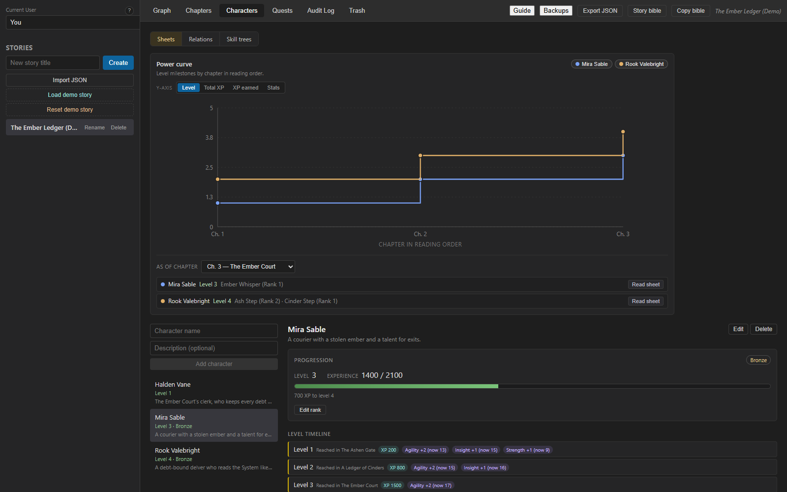
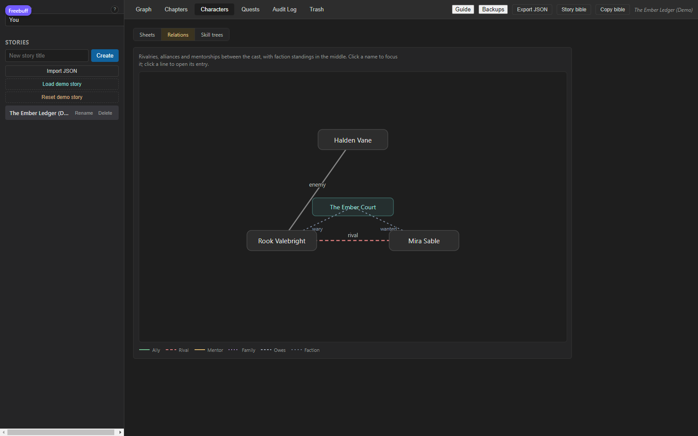
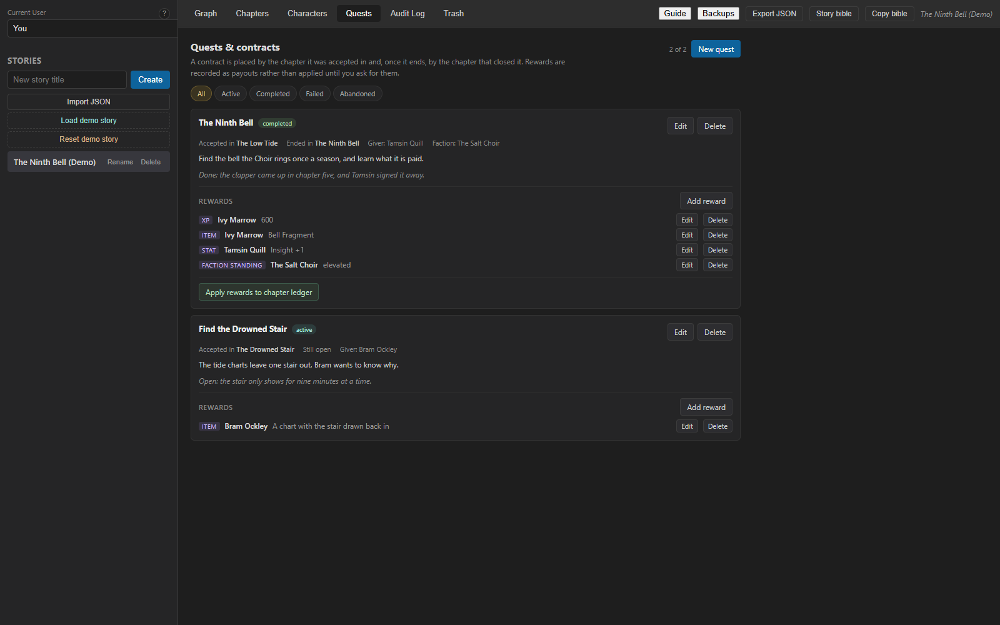
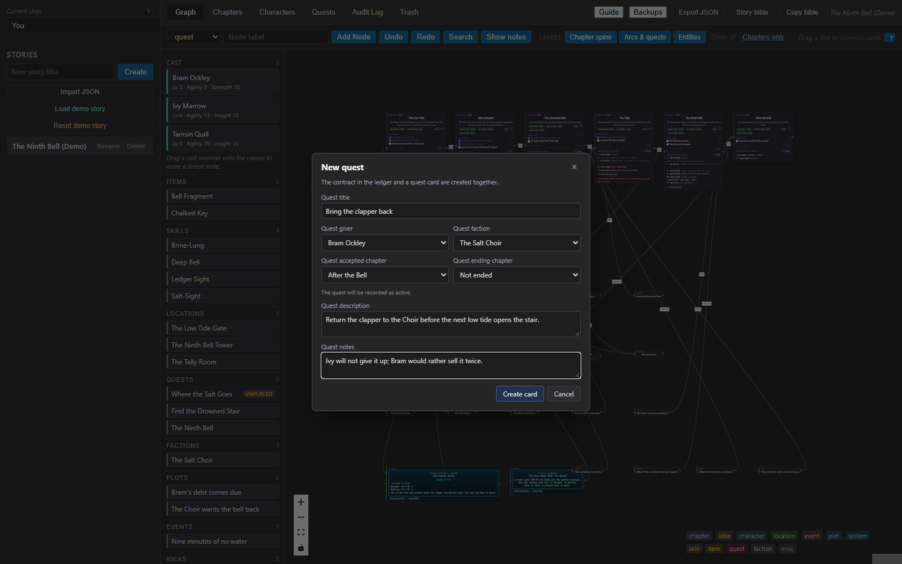
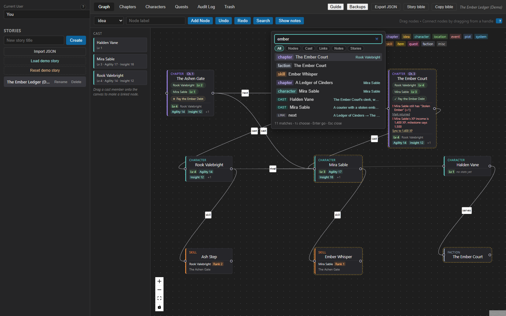

# Storyboarding a story

This is the author's guide: what to click, in what order, to turn an idea into a
storyboard you can draft from. It builds one story from an empty shelf to an
export, and every picture in it is of this app.

You can follow it on a story that already exists. Press **Load demo story** in the
sidebar and the board in these pictures appears: *The Ember Ledger*, three
chapters, three people, their numbers, two quests and a little trash. Every step
below names the same people and chapters, so you can look at the demo, then do it
on a story of your own.

This document lives in the app — it is what the header's **Guide** button opens.
If you would rather know how the thing works underneath (which part of the code
owns what, and what happens between a click and a row on disk), that is
[`GUIDE.md`](GUIDE.md), written for whoever changes the app next.

## Contents

1. [Get a story open](#1-get-a-story-open)
2. [Lay out the plot on the board](#2-lay-out-the-plot-on-the-board)
3. [Chapters are the spine](#3-chapters-are-the-spine)
4. [The cast, and who is in which chapter](#4-the-cast-and-who-is-in-which-chapter)
5. [A sheet that holds the numbers](#5-a-sheet-that-holds-the-numbers)
6. [Skills that travel between people](#6-skills-that-travel-between-people)
7. [Bonds and factions on one map](#7-bonds-and-factions-on-one-map)
8. [Quests, rewards and loot](#8-quests-rewards-and-loot)
9. [What a line between two cards means](#9-what-a-line-between-two-cards-means)
10. [When you change your mind](#10-when-you-change-your-mind)
11. [Find anything](#11-find-anything)
12. [Take it out of the app](#12-take-it-out-of-the-app)
13. [A short reference](#13-a-short-reference)

---

## 1. Get a story open

Two ways in. Type a title into **New story title** and press **Create** for an
empty story, or press **Load demo story** to get the example these pictures show.

*The sidebar holds your stories: newest first, with **Rename** and **Delete**
beside the open one. **Delete** moves a story to the Trash rather than destroying
it. **Import JSON** at the top of the shelf loads a story from a file (see
[section 12](#12-take-it-out-of-the-app)).*

A story opens on the **Graph** tab. Three things along the top are worth knowing
now: **Undo** and **Redo** walk your changes back and forward, the **?** button
beside your name lists every keyboard route, and the small **?** badges beside the
trickier controls explain them in a sentence or two.

If the welcome card is in your way, **Got it** puts it away for good; the three
rules it lists are the ones this guide closes with.

## 2. Lay out the plot on the board

The board is where you think. A card is one thing in the story, and the picker in
the toolbar says what kind you are about to add:

- **chapter**, **idea**, **location**, **event**, **plot**, **system**, **item**,
  **faction** and **misc** are plain notes. Type a label, press **Add Node**, and
  drag it where you want it.
- **character**, **quest** and **skill** open a short form instead, because those
  cards stand for real records — a person, a contract, a skill somebody holds.
  The form asks for the few things that make the record, creates it, and puts the
  card on the board already pointed at it.

*The board, its cast rail on the left and the legend of card types on the right.
Chapter cards are numbered, `Ch. 1` to `Ch. 3`; the boxes on the lines are the
words you gave those connections.*

To connect two cards, drag from the small circle on the side of one card onto the
other. The label on the new line defaults to what the line means — `next` between
two chapters, `cast` from a chapter to a person, `skill` from a skill card to
somebody who holds it — and you can change it later
([section 9](#9-what-a-line-between-two-cards-means)).

Some connections write more than a line. That is the point of the next three
sections: connecting a person to a chapter casts them in it, connecting two people
records a bond, and connecting a skill card to somebody gives them the skill.

Two more moves worth trying:

- **Drag from a card's circle into empty space** and the app opens the form for a
  new card, already filled in from where the drag started — drag off a character
  and the form knows who the owner or the quest-giver is; drag off a chapter and it
  knows which chapter the skill was learned in.
- **Select a card or a line and press Delete** (or `Backspace`) to remove it. The
  card's lines go with it, and everything lands in the Trash, where **Undo** or
  **Restore** can bring it back.

## 3. Chapters are the spine

Everything else hangs off the reading order. The **Chapters** tab lists every
chapter card in order, numbered from 1.

*Reading order at the top, the **Timeline** of in-world days below it, and the
**Continuity** advisories last. Each row carries what the chapter is: its arc, the
words written against the target, its POV, and the day and time it happens in.*

To build the order:

- **New chapter** makes a chapter card and puts it last. `Enter` in its title box
  does the same.
- Drag a row by its grip, or use the **↑** and **↓** arrows — the arrows move the
  same chapters from the keyboard. Dropping a row where it already was writes
  nothing.
- **Edit** on a row opens the details in place: **Arc**, **Words**, **Target**,
  **POV**, **Day**, **Time**. `Enter` saves; `Escape` or **Cancel** closes and asks
  first if you changed anything. A blank arc or POV stores nothing, while a count of
  zero is kept — "nothing written" and "no count" are different facts. The day is
  just a number of days, so `3` can mean "the third day since the System arrived".
  The time is your own words: `Dusk`, `18:40`, `after the fire`.
- **Renumber** appears when the numbers are missing, doubled or oddly ordered, and
  tidies them to 1..n. Until you press it, the tab tells you which positions are
  empty instead of silently fixing them.

The totals bar adds up what you have written against the targets that exist. The
**Timeline** puts the chapters that have a day in time order; **Continuity** lists
what looks inconsistent — a chapter with no POV, a chapter that names a time but no
day, a day that goes backwards, an item still carried after it was recorded lost —
and each flag is a link that opens the chapter it names. Nothing there is blocked:
the warnings are advice, and a story with none shows an empty panel.

**Notes** on a row holds anything you want to remember about that chapter: one line
each, **Ctrl/Cmd+Enter** saves, the panel counts them on the button. Switching away
or closing asks before a half-written note is dropped.

***Show notes** on the Graph toolbar pins the first three notes under their
chapters as small cards, with the rest counted on a `+N more` card. Click one and
it opens that chapter's note panel. The notes cards cannot be dragged and hiding
them writes nothing — they are there to read while you plot.*

## 4. The cast, and who is in which chapter

The **Characters** tab holds your cast: a name, an optional description, and
everything else in the next three sections. Type a name and press **Add
character**; the list shows what each person is (their level, and their rank if you
gave them one).

On the Graph tab, the **cast rail** is the same list. Drag a name onto the board
and you get a `character` card already linked to them; drop it onto an existing
card instead and that card is re-pointed at the cast member, keeping its label,
notes and type. Linked cards wear that person's numbers as small badges, so the
board tells you who is ahead without opening a sheet.

Then say who is where:

- **Connect a character card to a chapter card** and that person joins the
  chapter's cast. The chapter card then names everyone present — the character it
  is linked to, its POV, and everyone you added — with each one's level *as of that
  chapter*, not today.
- **Cast** on a chapter row opens the whole list with a checkbox each, so a party
  can share a scene without disturbing the two links the card already has (a POV
  and its own linked character).
- **Connect two character cards** and the app asks what the bond is before
  recording anything.

***Relation kind** is free text with suggestions: ally, rival, mentor, family or
enemy, or your own word. **Since chapter** is optional, and so is a **Note**. The
bond is written onto both sheets and the line on the board is labelled with the
same word — one bond, not two. **Connect characters** stays disabled until the kind
is typed, and closing the dialog writes nothing.*

## 5. A sheet that holds the numbers

Each cast member has a sheet. It is the record of who they were at each chapter,
which is what makes a storyboard more useful than a list of names.

*The **Power curve** at the top is drawn from the milestones below it: chapters
along the bottom in reading order, and a line per person. Switch the y-axis
between **Level**, **Total XP**, **XP earned** and any **Stats** you keep, and click
a name in the legend to take somebody off the picture while you look at the rest.
Under it, **As of chapter** answers the other question: pick a chapter and the panel
says what each person's level was and which skills they still held at that point —
without redrawing anything by hand. **Read sheet** on any of those rows opens the
rest of that person's sheet as it stood then: their stats and the chapter that
recorded each one (with today's number beside it when it has moved), the skills
with the rank they had at the time, and what they were carrying. A stat with no
recorded number yet shows a dash, not a zero.*

*Below the progression bar come **Level timeline**, **Level growth**, **XP by
chapter** and **Awards**, then **Attributes**, **Skills**, **Inventory**,
**Currency** and the two ledgers of the next sections. Everything you type is
typed where the thing is, not into a separate settings screen.*

What the numbers mean, and what they do not:

- **Progression** is a level, an experience total and a rank, and only the rank is
  yours to type: **Edit rank** is the one field on the line. The experience is the
  XP ledger added up, and the level is what your story's curve buys with it — so
  the sheet counts down to the next level by itself and there is no target to
  enter. There is no **Record level-up** button any more, because a level is no
  longer something you write down.
- **Level timeline** is what the curve wrote: a level, the chapter whose income
  crossed it, and the stats the rule handed out there. You do not edit these rows;
  you record experience below and they follow. Deleting the entry that paid for a
  level takes the level and its gains back off the sheet.
- **Level growth** is the curve plus what a level hands out: XP for the second
  level and a percentage more for each one after it, a number of points to place,
  and any stats that rise every level (`Strength +1`). The story has one rule and a
  character can override it — a monster that levels at 300 XP where people need
  700, a human who gets nothing free.
- **XP by chapter** is income, and it is what levels the character: what chapter 2
  paid out. Recording the same character and chapter twice is refused, because one
  amount is what a chapter pays.
- **Awards** are the gains that skip a level-up: XP a chapter paid, or a stat point
  from a blessing or a hidden quest. Adding one applies it, and deleting it takes it
  back out. A skill keeps its own clock too — its rank can rise in a chapter where
  nobody levelled.
- **Attributes** are the free text a stat cannot hold — `Class: Delver`,
  `Homeland: Ashfall`.

The Chapters tab compares milestones across the reading order, so a level that goes
backwards without a penalty flag, a skill used before it was learned, a stat whose
sheet value no longer matches the last level-up that recorded it, or an XP total
that disagrees with the income rows shows up as a continuity warning with a link to
the exact row to fix. When there is only one number to choose between, the warning
also carries the fix itself: **Set to 12** writes the level-up's value onto the
sheet, and **Sync to 1,400 XP** writes the ledger's sum onto the milestone. Either
one is a single undoable step.

Names are matched the way you would match them by eye: capitals and stray spaces do
not matter, so `strength` in one level-up and `Strength` in the next are the same
stat. If the sheet calls it something close — `STR`, or a misspelling — the warning
says so: *but the sheet has “STR” — likely the same stat under another name*, rather
than telling you it was dropped. Nothing is written on that guess, so rename or
re-type it on the sheet yourself; the warning clears once the two agree.

## 6. Skills that travel between people

A skill is one thing, however many people hold it. **A skill card has one
identity**: its name, rank and effect belong to the skill, and a correction made on
the card reaches every sheet that holds it, in one step.

Make one either way: add it on a character's sheet with **Add skill**, or drop a
**skill** card on the board and open it.

*Clicking a skill card slides the inspector in beside the board: the card's own
label and notes, the cast member it is linked to, and its **Holders** — who holds
this skill, at what rank, and which chapter they learned it in. The form at the
bottom adds another holder; the character picker leaves out anyone who already
holds it.*

*Rank and chapter are per holder; the name and effect come from the card. Type them
and press **Add holder** (or drag a line from the card to a character, which is the
same write without the form).*

*The **Skill trees** view on the Characters tab draws what grew out of what, tier
by tier, with solid blue arrows for upgrades, golden for fusions, dashed purple for
mutations and dashed teal for branches. The **Character** picker follows the tree
outwards, so a fusion pulls in somebody else's skill. Click a skill to see what it
**Requires** and what it **Evolves into**; click a line for its chapter, required
rank and notes. A link that would close a loop is refused, and while you are
choosing the other end the panel names the chain it would make and draws it red.
Deleting the skill takes its links with it; the sheet is where ranks and events
live.*

## 7. Bonds and factions on one map

The same relations, seen at once: **Relations** is the third view of the Characters
tab.

*The cast on a ring, faction cards in the middle, and each bond drawn in its kind's
colour and line shape — ally solid green, rival dashed red, mentor amber with an
arrow, family dotted violet, owes dashed grey. Click a name to focus one person and
dim the rest; click a line to open that bond or faction standing in its editor, on
the sheet where it is stored. **Faction standings** work the same way from the
other side: which faction card, the place held there in your words, and the chapter
it began in.*

## 8. Quests, rewards and loot

The **Quests** tab is the ledger of contracts.

*A quest is a title, the chapter it was accepted in, the chapter that closed it, a
status of your choosing (**active**, **completed**, **failed** and **abandoned** are
the suggestions, and the filter row across the top comes from the words you
actually used), an optional giver and faction card, an objective and private notes.
Choosing an ending chapter marks it **completed**; clearing that chapter reopens it
and the form refuses a status that says a quest ended while no ending chapter is
set. A quest shows as a badge on both chapters it names — a diamond where it was
accepted, a tick where it ended — and clicking the badge opens it here.*

*The other way in, from the board: choose `quest` in the toolbar's type list and
press **Add Node**. The same things are asked for — title, giver, faction card, the
chapter it was accepted in and the chapter that closed it — and **Create card**
writes the ledger row and the card together, so a quest on the board and a quest in
the ledger can never say different things. Left on **Not ended** it is recorded as
active; given an ending chapter, it is completed. The card lands on the board, and
its dot is what you drag from to link it to the chapters it is about.*

**Rewards** are the rows under the quest: XP, an item, a stat gain or a faction
standing, each with the character or faction it goes to and your own wording. They
are recorded rather than paid until you say so, because a payout is not something
to do twice by accident. **Apply rewards to chapter ledger** on a finished quest
fills in the numeric XP on each character's income row and the items in their
inventory for the ending chapter, adding to an existing XP row instead of
duplicating it and telling you the before and after. Stat gains and standings are
left alone — they are written in your words — and each reward remembers when it
last landed, so **Apply new rewards** pays only what is still unpaid. Applying the
same bundle twice asks first.

Loot itself belongs to the sheet: **Inventory** is items with a rarity, a quantity,
an effect and the chapters they were acquired and lost in, and **Currency** is a
separate named ledger — marks, credits, mana crystals — with an amount and no
exchange rate. Nothing here does arithmetic between currencies, on purpose.

## 9. What a line between two cards means

Click any line on the board and it opens for editing.

*A line has an optional **Label** and a relation type, which is the line's verb:
`leads_to` and `foreshadows` are the usual ones, and `unlocks`, `requires` and
`rewards` are suggested. Both are free text, and the label is what the board shows;
without one it falls back to the type. Each field you change is its own entry in the
history, so rewording a label is not buried under a change to the type.*

The exception is a line that stands for a bond between two people. Its relation type
is what the sheet was given, so clearing it would leave the bond without its
drawing: the editor refuses and asks for another word instead. To remove that bond,
delete the line — which takes the relation with it, as one undoable step.

## 10. When you change your mind

**Ctrl+Z** or **Undo** takes back the last change on the board, and **Ctrl+Shift+Z**
or **Redo** puts it back. Inside a text field `Ctrl+Z` is left to the text you are
typing. One gesture is one step, even when it wrote two things at once — a cast
member and the line that drew them, a relation and its line, a skill and its hold.
A short notice names what moved, and the stack holds the last 50 changes of the
story you have open.

*The **Audit Log** is the longer record: every change, with who made it, the field,
and the value before and after. Newest first, 50 at a time, and filtered by kind
with the buttons across the top — stories, characters, stats, attributes, nodes,
skills, inventory, currency, relations, standings, quests, their rewards,
connections, or the history itself. **Show older changes** pages further back and
says how many are still there.*

Any single field in that list can be put back with **Revert**, and a revert is
itself recorded, so it can be reverted in turn. The button tells you before you
click whether it will work — *Changed since*, *In trash*, *Gone*, *Already back*,
with the reason in its tooltip — because it only applies while the field still holds
the value that entry produced. Creations and deletions are the Trash's business, and
links the history stores as names (a chapter, a card) cannot be reverted.

*Deleting a story, a person, a card or a line moves it here. **Restore** puts it
back as it was: a person with their stats and attributes, a card with the lines that
went with it, a story with everything that was live inside it. **Delete forever** is
the only irreversible thing in the app and it asks first. **Keep deleted items for**
decides how long the trash holds things — forever by default, or 7, 30, 90 days or a
year, cleared when the app starts.*

A deleted chapter is the one thing that does not come back whole: its cast rows were
never deleted with it, and its lines wait in the trash to be restored one at a time.
The notice after undoing a chapter deletion says how many lines are waiting.

## 11. Find anything

**Ctrl+F** on the Graph or Chapters tab opens the search palette; the **Search**
buttons do the same. On the board it floats over the canvas, and on the Chapters tab
it sits above the reading order so you can find a note without leaving the tab.

*The palette with one word typed. Each result carries its kind on the left — a
card's own type, `CAST` for a person, `LINK` for a connection — and what the kind
needs on the right: the cast member a card belongs to, both ends of a line, the
chapter holding a note. The cards the word matched are outlined on the board behind
it, and the last line counts the matches and names the keys — **↑** and **↓** to
choose, `Enter` to go, `Esc` to close.*

A query is matched against a card's label, notes, type and linked cast member; a
person's name and description; both ends of a line and its label or relation type;
the text of every chapter note; and every story by title, description or the cards
inside it — other stories' boards and notes are read when the palette opens, so a
word can be found without opening the story that holds it. Matching cards are
outlined on the board as you type, the first eight results are listed, **↑** and
**↓** move through them, `Enter` goes to the one you chose and `Esc` closes the
palette. The filter row under the query narrows the list to one kind, and the count
follows the filter. What a result opens is the thing itself: a card in the
inspector, a person's sheet, a line in its editor centred on the board, a note with
its chapter's panel expanded and the note marked, a story on its own board.

## 12. Take it out of the app

Three ways out, all from the header:

- **Story bible** writes a Markdown file beside your database: the title, the
  chapters in reading order with their arc, day, POV, counts and notes, then the
  cast with their numbers, skills and belongings, then the other cards grouped by
  kind. It is written in plain language with no app jargon, so it can be pasted
  straight into whatever you draft in. **Copy bible** puts the same text on the
  clipboard without writing a file.
- **Export JSON** writes the whole story, history included, as one file. **Import
  JSON** in the sidebar reads one back as a **new** story: importing the same file
  twice gives you two independent stories, and a title that already exists becomes
  `<title> (imported)`. Nothing you already have is touched.
- **Backups** lists the copies the app wrote at each launch, newest first, with when
  each was written and how big it is. Restoring one asks first, copies the current
  state into a new backup, and then replaces the database — which drops the undo
  history and any open drafts, because they describe rows that no longer exist.

Your work lives in a single file on your own machine (`Data location` in
[`README.md`](README.md) says where), and nothing leaves it unless you export it.

## 13. A short reference

| I want to… | Where it is |
| --- | --- |
| Start a story, or load the demo | Sidebar: **New story title** → **Create**, or **Load demo story** |
| Add a card for anything | Graph toolbar: pick the type, type a label, **Add Node** |
| Add a person, a quest or a skill | Pick `character`, `quest` or `skill` and **Add Node** for the full form |
| Draw a relationship | Drag from a card's circle onto another card |
| Put a person in a chapter | Connect their card to the chapter card, or **Cast** on the chapter row |
| Change the reading order | Chapters tab: drag a row's grip, or the **↑**/**↓** arrows |
| Record experience, a stat or a rank | The person's sheet: **Add XP** (the ledger, which is what levels them), **Add award**, **Edit rank** |
| See the story's shape | Characters tab: the **Power curve**, and **As of chapter** |
| Record what a chapter paid out | Quests tab: rewards, then **Apply rewards to chapter ledger** |
| Take back a change | **Ctrl+Z**, the **Undo** button, or **Revert** in the Audit Log |
| Undo a deletion | **Restore** in the Trash |
| Read a chapter's notes | Chapters tab: **Notes** on its row, or **Show notes** on the board |
| Find a word anywhere | **Ctrl+F** |
| Get the story out | **Story bible**, **Copy bible** or **Export JSON** in the header |
| See every keyboard route | The **?** button beside your name, or press `?` |

---

The app is made of a few ideas that do not change: the board and the sheets write
the same records, so a line is never just a line; a skill has one identity, so its
edits reach every holder; and history goes back whole actions, so one undo is one
action rather than half of one. Everything above follows from those three.

When you want to know *why* something behaves the way it does, or you are changing
the app rather than using it, [`GUIDE.md`](GUIDE.md) walks the whole trip from a
click to a row on disk.
